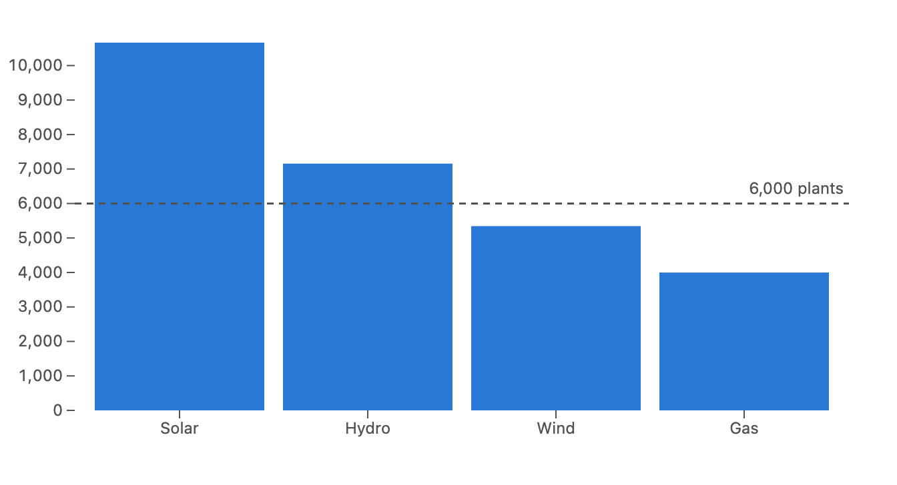
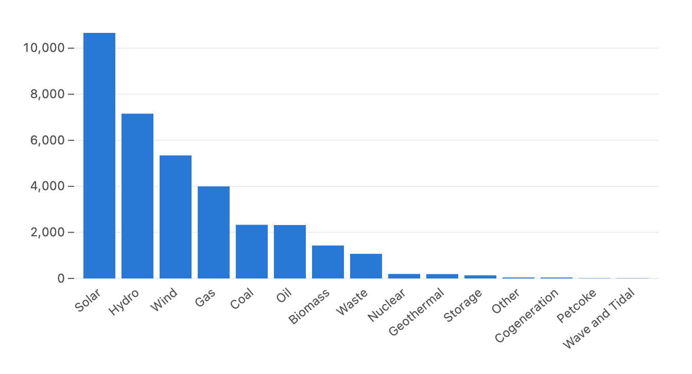
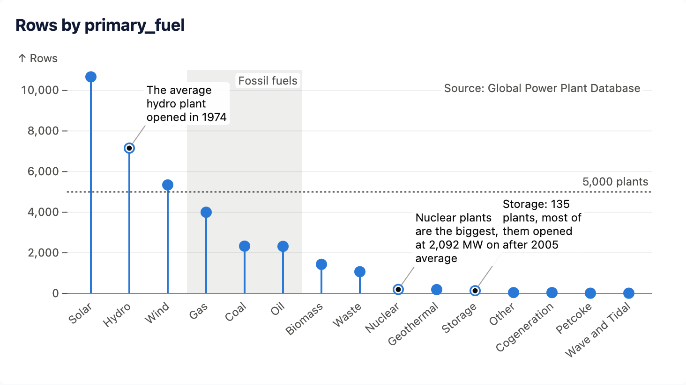
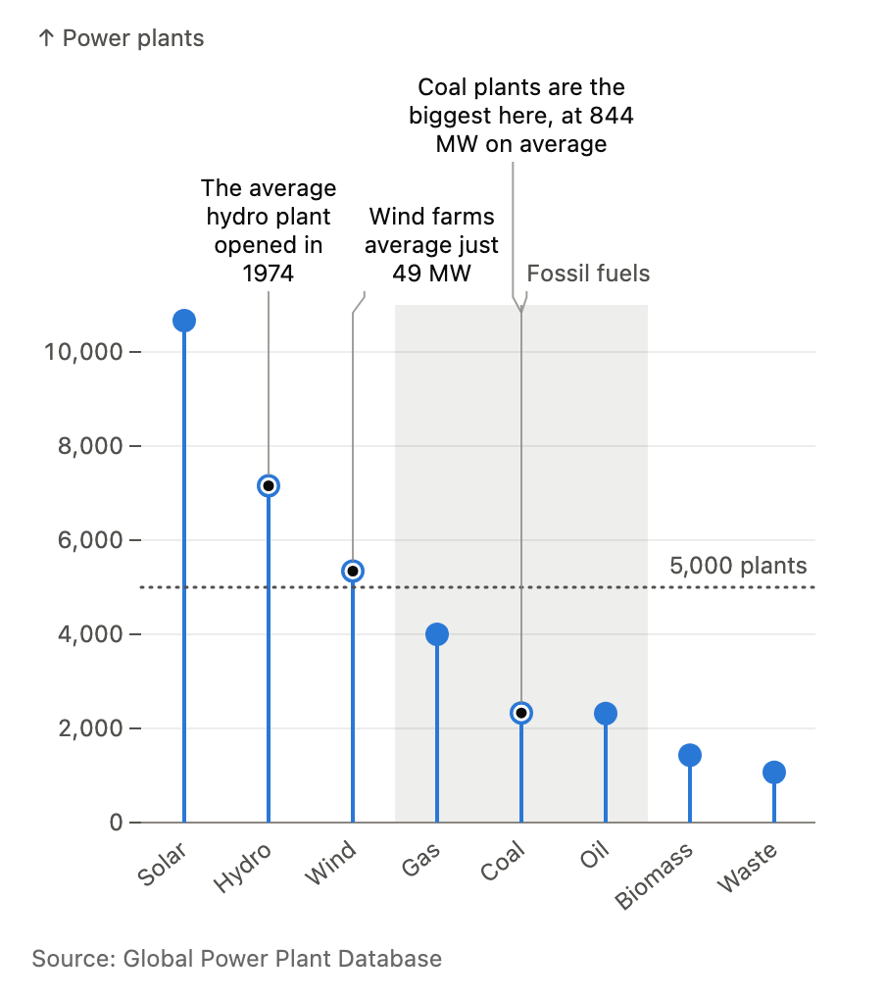
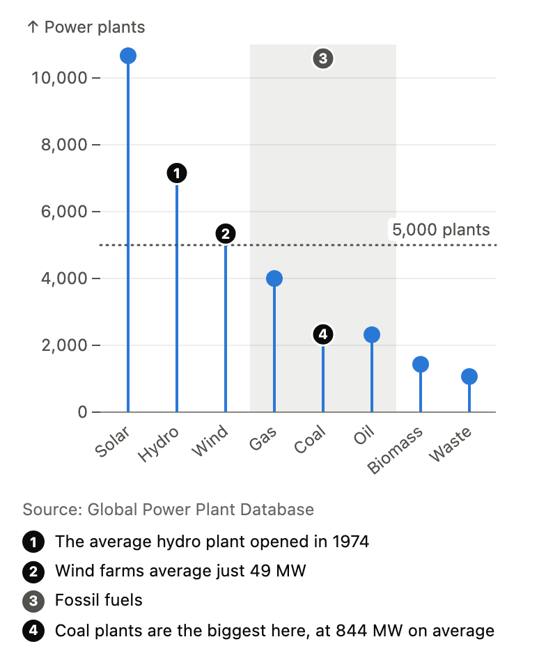

# JavaScript helpers for chart renderers

A chart type from another plugin draws its charts with a JavaScript module, the chart type's `js_url`. That module exports a `render(el, ctx)` function, which draws the chart into the element `el`. The [README](../README.md#adding-chart-types) covers the Python half of a chart type.

`ctx.helpers` holds the functions the built-in renderers draw with. They are the very same functions, so a renderer that uses them looks like the built-in charts, follows the page's light or dark theme and can draw [annotations](../README.md#annotations). Only the helpers on this page are public: the rest of `renderers/common.js` and `renderers/annotations.js` can change at any time. New helpers will be added over time. This interface is not stable yet: until it is, a helper here could still change, and any change will be in the release notes.

In the examples, `// =>` shows what an expression returns. The test suite runs every one of those against the real helpers and checks the result. Results that depend on the browser's fonts say so, and come from Chromium on macOS. Unless an example says otherwise, `ctx` is a full-size chart 640 pixels wide on a white page.

## Contents

- [A minimal renderer](#a-minimal-renderer)
- [What a renderer is handed](#what-a-renderer-is-handed): [`ctx`](#ctx) and [`ctx.theme`](#ctxtheme)
- [Setting up a plot](#setting-up-a-plot): [`basePlot`](#baseplotctx-options), [`mount`](#mountel-ctx-plot), [`isThumbnail`](#isthumbnailctx), [`TIP`](#tip), [`xLabel`](#xlabellabel), [`valueAxisMargin`](#valueaxismarginvalues-fontfamily)
- [Numbers and labels](#numbers-and-labels): [`fmt`](#fmtvalue), [`fmtCompact`](#fmtcompactvalue), [`truncate`](#truncatetext-max), [`categoryName`](#categorynamekey-isother-label), [`uniqueNames`](#uniquenamesnames), [`seriesColor`](#seriescolortheme-index), [`textWidth`](#textwidthtext-font), [`fitBandLabels`](#fitbandlabelslabels-options), [`orderedValues`](#orderedvalueskeys)
- [Time buckets](#time-buckets): [`bucketToDate`](#buckettodatebucket-unit), [`stepDate`](#stepdatedate-unit), [`fmtBucket`](#fmtbucketdate-unit), [`allBuckets`](#allbucketsdates-unit-max)
- [Annotations](#annotations): [`annotate`](#annotateel-ctx-make-axes), [`bandMatcher`](#bandmatchernames-keys), [`parseMoment`](#parsemomentvalue)

## A minimal renderer

This is a whole renderer, for a chart type whose SQL returns `key` and `value` columns. It draws a bar for each row and takes every kind of annotation:

```javascript
// simple_bar.js
export function render(el, ctx) {
  const { Plot, helpers, theme } = ctx;
  const { basePlot, mount, annotate, bandMatcher } = helpers;
  const keys = ctx.data.map((d) => d.key);
  const options = basePlot(ctx, {
    x: { domain: keys, label: null },
    y: { label: null },
    marks: [Plot.barY(ctx.data, { x: "key", y: "value", fill: theme.series[0] })],
  });
  const plot = annotate(el, ctx, (margins) => Plot.plot({ ...options, ...margins }), {
    x: { screen: "x", kind: "band", match: bandMatcher(keys, keys) },
    y: { screen: "y", kind: "number" },
  });
  mount(el, ctx, plot);
}
```

Its chart type says which annotations it draws, and what its x and y are:

```python
class SimpleBarChart(ChartType):
    name = "simple_bar"
    label = "Simple bar chart"
    js_url = "/-/static-plugins/datasette-simple-bar/simple_bar.js"
    annotation_types = ("line", "range", "point", "text")
    annotation_axes = {"x": "category", "y": "number"}
    # This renderer cannot look up a bar's value, so a callout must give its y
    annotation_lookup = False
    ...
```

With four rows and one annotation, `{"type": "line", "y": 6000, "text": "6,000 plants"}`, it draws this:



Without `marks` in its `axes`, `annotate()` does not know where the bars are, so here it could put a label on top of one. The [worked example](#a-worked-example) shows how to tell it.

The built-in renderers in [`datasette_charts/static/renderers/`](../datasette_charts/static/renderers/) are fuller examples. They import the helpers from `common.js` and `annotations.js`; a renderer from another plugin takes them from `ctx.helpers` instead.

## What a renderer is handed

### `ctx`

A renderer can rely on these fields of `ctx`. Any others are internal to this plugin and can change.

| Field | What it holds | Example |
|---|---|---|
| `spec` | The chart's spec, annotations included | `{v: 1, type: "simple_bar", encoding: {...}, annotations: [...]}` |
| `rows` | The rows the chart type's SQL returned, as arrays | `[["Solar", 10665], ["Hydro", 7156]]` |
| `columns` | The names of those columns | `["key", "value"]` |
| `data` | The same rows as objects keyed by column name | `[{key: "Solar", value: 10665}, {key: "Hydro", value: 7156}]` |
| `meta` | What the chart type's `compile()` returned as `meta`, such as the time unit | `{timeUnit: "month", y: "Count"}` |
| `size` | `"full"` or `"thumbnail"`. Thumbnails have no axes, labels or legends | `"full"` |
| `width`, `height` | The size to draw at, in pixels. Full-size charts are at least 320 wide and 340 high; thumbnails are 208 by 112 | `640`, `340` |
| `Plot`, `d3` | [Observable Plot](https://observablehq.com/plot/) and [D3](https://d3js.org/), as bundled with this plugin | |
| `theme` | The colors for the page the chart is on, light or dark (below) | |
| `helpers` | The helpers on this page, as a frozen object | `{fmt, basePlot, annotate, ...}` |

The renderer does no data fetching: the rows are already aggregated by the chart type's SQL.

### `ctx.theme`

The theme is picked from the background the chart actually sits on, so it follows whatever theme the page uses, not just the operating system's setting.

| Token | What it holds | Light | Dark |
|---|---|---|---|
| `mode` | `"light"` or `"dark"` | `"light"` | `"dark"` |
| `surface` | The background behind the chart | `"rgb(255, 255, 255)"` | the page's own, such as `"rgb(17, 26, 53)"` |
| `ink` | Text that should stand out | `"#0b0b0b"` | `"#f0efec"` |
| `ink2` | Ordinary text, such as tick labels | `"#52514e"` | `"#c3c2b7"` |
| `muted` | Rules and secondary marks | `"#898781"` | `"#898781"` |
| `grid` | Gridlines | `"#e1e0d9"` | `"#2c2c2a"` |
| `series` | Eight colors for series, in the order to use them | `["#2a78d6", "#eb6834", ...]` | `["#3987e5", "#d95926", ...]` |
| `other` | The color for an "Other" series, and any series past the eighth | `"#a8a69f"` | `"#6f6e69"` |
| `sequential` | Two ends of a color ramp, the first for values near zero | `["#cde2fb", "#0d366b"]` | `["#104281", "#cde2fb"]` |
| `land` | Land on a map | `"#ecebe6"` | `"#2c2c2a"` |

The whole light theme:

```javascript
ctx.theme
// => {
//   mode: "light",
//   surface: "rgb(255, 255, 255)",
//   series: ["#2a78d6", "#eb6834", "#1baf7a", "#eda100", "#e87ba4", "#008300", "#6250d6", "#e34948"],
//   sequential: ["#cde2fb", "#0d366b"],
//   other: "#a8a69f",
//   land: "#ecebe6",
//   grid: "#e1e0d9",
//   muted: "#898781",
//   ink: "#0b0b0b",
//   ink2: "#52514e"
// }
```

## Setting up a plot

### `basePlot(ctx, options)`

The options every plot starts from: the chart's size, its font and text color, and a transparent background. A full-size chart gets a 44 pixel bottom margin, room for an x axis label under the ticks. A thumbnail gets no axes and a 6 pixel margin all round, so one renderer can draw both sizes.

- `ctx`: the renderer's `ctx`.
- `options`: any [Plot options](https://observablehq.com/plot/features/plots). They are merged over the defaults, one level deep: passing `style` replaces the whole `style` object.
- Returns an options object for `Plot.plot()`.

```javascript
const plot = Plot.plot(
  basePlot(ctx, {
    marginLeft: 60,
    y: { label: ctx.meta.y, grid: !isThumbnail(ctx), nice: true },
    marks: [Plot.barY(ctx.data, { x: "key", y: "value", fill: ctx.theme.series[0] })],
  })
);
```

```javascript
basePlot(ctx, { marginLeft: 60 })
// => {
//   width: 640,
//   height: 340,
//   style: { background: "transparent", color: "#52514e", fontFamily: "inherit", fontSize: "12px", overflow: "visible" },
//   marginBottom: 44,
//   marginLeft: 60
// }

basePlot({ ...ctx, size: "thumbnail", width: 208, height: 112 })
// => {
//   width: 208,
//   height: 112,
//   style: { background: "transparent", color: "#52514e", fontFamily: "inherit", fontSize: "12px", overflow: "visible" },
//   axis: null,
//   margin: 6
// }
```

### `mount(el, ctx, plot)`

Puts a drawn plot into `el`, replacing whatever was there. Call it last, with the plot `annotate()` returned. It also sets what Plot reads from CSS: tooltips are filled with the theme's `surface` color, so they match a dark page, and the plot never gets wider than its container.

- `el`: the element `render()` was given.
- `ctx`: the renderer's `ctx`.
- `plot`: what `Plot.plot()` returned, an `<svg>`, or a `<figure>` when the plot has a legend.
- Returns nothing.

```javascript
const plot = Plot.plot(basePlot(ctx, { marks }));
mount(el, ctx, plot);
```

After that, in Chromium, the start of `el.innerHTML` is the plot's `<svg>` with those two styles set:

```html
<svg class="plot-d6a7b5" fill="currentColor" font-family="system-ui, sans-serif" font-size="10" text-anchor="middle" width="640" height="340" viewBox="0 0 640 340" style="background: none; color: rgb(82, 81, 78); font-family: inherit; font-size: 12px; overflow: visible; --plot-background: rgb(255, 255, 255); max-width: 100%;">
```

### `isThumbnail(ctx)`

Whether the chart is a thumbnail, in the row of suggestions. Thumbnails are 208 by 112 pixels, with no axes, labels, legends or tooltips, so leave out anything that only makes sense at full size.

- `ctx`: the renderer's `ctx`.
- Returns `true` or `false`.

```javascript
const thumbnail = isThumbnail(ctx);
const dots = Plot.dot(ctx.data, {
  x: "x",
  y: "y",
  r: thumbnail ? 1.5 : 3,
  ...(thumbnail ? {} : { title: (d) => fmt(d.y), tip: TIP }),
});
```

```javascript
isThumbnail(ctx) // => false
isThumbnail({ ...ctx, size: "thumbnail" }) // => true
```

### `TIP`

Options for Plot's tooltips, which give the lines of a tooltip a little more space than Plot does. Spread it into a `Plot.tip()` mark, or pass it as a mark's `tip` option. It is frozen, so copy it to change it: `{ ...TIP, fontSize: 13 }`.

```javascript
// A tooltip on each bar
Plot.barY(bars, { x: "name", y: "value", title: (d) => `${d.name}\n${fmt(d.value)}`, tip: TIP });

// One tooltip that follows the pointer along a line
Plot.tip(points, Plot.pointerX({ x: "date", y: "value", title: (d) => fmt(d.value), ...TIP }));
```

```javascript
TIP // => { lineHeight: 1.3 }
```

### `xLabel(label)`

Axis options that put the x axis label centred under the ticks, where it cannot run into them. `basePlot()` leaves room for it. Spread it into the `x` options.

- `label`: the label, usually a column name.
- Returns `{label, labelAnchor}`.

```javascript
basePlot(ctx, { x: { ...xLabel(ctx.meta.x), grid: true }, marks });
```

```javascript
xLabel("capacity_mw") // => { label: "capacity_mw", labelAnchor: "center" }
```

### `valueAxisMargin(values, fontFamily)`

A left margin wide enough for the tick labels of a value axis showing `values`, such as "1,200,000", which Plot's default margin would cut off. It is never less than 56 pixels. It measures the text, so it needs a browser.

- `values`: the numbers the axis shows. Anything that is not a finite number is ignored.
- `fontFamily`: the font the labels are drawn in, `getComputedStyle(el).fontFamily`. Defaults to `"system-ui, sans-serif"`.
- Returns a number of pixels.

```javascript
const fontFamily = getComputedStyle(el).fontFamily;
const marginLeft = isThumbnail(ctx) ? 6 : valueAxisMargin(ctx.data.map((d) => d.value), fontFamily);
```

In Chromium, inside the plugin's panel, whose font is `system-ui, -apple-system, "Segoe UI", sans-serif`:

```javascript
valueAxisMargin([120, 4500, 1200000], fontFamily) // 75
valueAxisMargin([-25000, 18000], fontFamily) // 66
valueAxisMargin([3, 12, 48], fontFamily) // 56
valueAxisMargin([], fontFamily) // 56
```

## Numbers and labels

### `fmt(value)`

A number as it should read in a tooltip: with thousands separators and at most two decimal places. `null` and `undefined` become an empty string, and anything else is turned into a string as it is. Years read badly with separators, so write those with `String(year)`.

- `value`: anything.
- Returns a string.

```javascript
Plot.barY(bars, { x: "name", y: "value", title: (d) => `${d.name}\n${fmt(d.value)}`, tip: TIP });
```

```javascript
fmt(1284.567) // => "1,284.57"
fmt(0.125) // => "0.13"
fmt(1000000) // => "1,000,000"
fmt(2009) // => "2,009"
fmt(null) // => ""
fmt("n/a") // => "n/a"
```

### `fmtCompact(value)`

A number short enough to write beside a mark, such as a value at the end of a bar: whole numbers from 100, and K, M and B from 10,000. Anything that is not a number goes through `fmt()`.

- `value`: anything.
- Returns a string.

```javascript
Plot.text(bars, { x: "name", y: "value", text: (d) => fmtCompact(d.value), dy: -7, fill: ctx.theme.ink2 });
```

```javascript
fmtCompact(7.25) // => "7.25"
fmtCompact(1284.567) // => "1,285"
fmtCompact(12900) // => "12.9K"
fmtCompact(-15300) // => "-15.3K"
fmtCompact(4210000) // => "4.2M"
fmtCompact(null) // => ""
```

### `truncate(text, max)`

`text` cut to at most `max` characters, the last of them an ellipsis. Use it for tick labels, which cannot wrap.

- `text`: anything, turned into a string.
- `max`: the most characters to keep, the ellipsis included.
- Returns a string.

```javascript
y: { label: null, domain: names, tickFormat: (name) => truncate(name, 28) }
```

```javascript
truncate("United States of America", 16) // => "United States o…"
truncate("France", 16) // => "France"
```

### `categoryName(key, isOther, label)`

The name to show for a category value. Use it for every category and series name, so that they read the same as on the built-in charts.

- `key`: the value from the row.
- `isOther`: whether this row is the "Other" bucket that the top N leaves behind. Built-in chart types return an `is_other` column for this.
- `label`: the label of a foreign key, if the column is one. Built-in chart types return it in a `label` column.
- Returns a string: "Other", the label, the key, `"(null)"` or `"(empty)"`.

```javascript
const names = ctx.data.map((d) => categoryName(d.key, d.is_other, d.label));
```

```javascript
categoryName("CA", false, "California") // => "California"
categoryName("CA", false) // => "CA"
categoryName(null, false) // => "(null)"
categoryName("", false) // => "(empty)"
categoryName(null, true) // => "Other"
```

### `uniqueNames(names)`

Makes a list of names unique by numbering repeats, since a band scale needs one name per band. Two keys can share a foreign key label, such as two towns with the same name.

- `names`: a list of strings.
- Returns a new list of the same length.

```javascript
const names = uniqueNames(ctx.data.map((d) => categoryName(d.key, d.is_other, d.label)));
```

```javascript
uniqueNames(["Springfield", "Shelbyville", "Springfield", "Springfield"])
// => ["Springfield", "Shelbyville", "Springfield (2)", "Springfield (3)"]
```

### `seriesColor(theme, index)`

The color for the series at `index`, counting from 0. The colors are never reused: past the eighth series, every one is drawn in the theme's `other` color.

- `theme`: `ctx.theme`.
- `index`: the series' place, largest first. Leave out "Other" when counting, and give it `theme.other`.
- Returns a color.

```javascript
let slot = 0;
const range = series.map((s) => (s.other ? theme.other : seriesColor(theme, slot++)));
const plot = Plot.plot(basePlot(ctx, { color: { domain: series.map((s) => s.name), range, legend: true }, marks }));
```

```javascript
seriesColor(ctx.theme, 0) // => "#2a78d6"
seriesColor(ctx.theme, 1) // => "#eb6834"
seriesColor(ctx.theme, 7) // => "#e34948"
seriesColor(ctx.theme, 8) // => "#a8a69f"
```

### `textWidth(text, font)`

The width of `text` in pixels, measured with a canvas.

- `text`: anything, turned into a string.
- `font`: a CSS font, such as `"12px system-ui"`.
- Returns a number.

```javascript
const fontFamily = getComputedStyle(el).fontFamily;
const widest = Math.max(...bars.map((d) => textWidth(fmtCompact(d.value), `12px ${fontFamily}`)));
// Only write values above the bars if they fit
const showValues = widest + 4 <= step;
```

In Chromium:

```javascript
textWidth("1,200,000", "12px system-ui") // 56.26171875
textWidth("Wave and Tidal", `12px ${fontFamily}`) // 85.763671875
```

### `fitBandLabels(labels, options)`

How to write the labels of a band axis, such as one under upright bars, so they do not run into each other. These are tried in order, until the labels fit:

1. level, at 12px, if they fit side by side
2. turned 40 degrees, at 12px, then smaller, down to 9px
3. turned 60 degrees, then upright, at 9px
4. for ordered values such as years only, every second label, or every third, and so on

Named categories never lose a label: if they do not fit upright, they are drawn upright at 9px anyway.

- `labels`: the labels as they will be written, already truncated.
- `options.step`: how many pixels each band takes along the axis.
- `options.fontFamily`: the font, `getComputedStyle(el).fontFamily`.
- `options.ordered`: whether labels may be left out, from [`orderedValues()`](#orderedvalueskeys).
- Returns `{fontSize, angle, every, marginBottom, overhang}`: the font size, the angle to turn the labels by, to write every Nth label, the bottom margin the turned labels need, and how far the first label reaches left of the middle of its band, for the left margin.

It measures the labels, so it needs a browser. Here it is in a whole renderer, for upright bars:

```javascript
// upright_bar.js
export function render(el, ctx) {
  const { Plot, helpers, theme } = ctx;
  const { basePlot, mount, isThumbnail, fitBandLabels, orderedValues, valueAxisMargin, truncate } = helpers;
  const thumbnail = isThumbnail(ctx);
  const fontFamily = getComputedStyle(el).fontFamily;
  const names = ctx.data.map((d) => String(d.key));
  const marginLeft = thumbnail ? 6 : valueAxisMargin(ctx.data.map((d) => d.value), fontFamily);
  const step = (ctx.width - marginLeft - 16) / names.length;
  const fit = fitBandLabels(names.map((name) => truncate(name, 28)), {
    step,
    fontFamily,
    ordered: orderedValues(names),
  });
  const axis = Plot.axisX({
    label: null,
    tickSize: 0,
    tickRotate: -fit.angle,
    fontSize: fit.fontSize,
    ticks: names.filter((name, i) => i % fit.every === 0),
    tickFormat: (name) => truncate(name, 28),
  });
  const plot = Plot.plot(
    basePlot(ctx, {
      marginLeft,
      marginRight: thumbnail ? 6 : 16,
      marginBottom: thumbnail ? 6 : fit.marginBottom,
      x: { domain: names, padding: 0.15, axis: null },
      y: { grid: !thumbnail, label: null },
      marks: [
        ...(thumbnail ? [] : [axis]),
        Plot.barY(ctx.data, { x: (d) => String(d.key), y: "value", fill: theme.series[0] }),
      ],
    })
  );
  mount(el, ctx, plot);
}
```

With the fifteen fuel types of the [Global Power Plant Database](https://github.com/wri/global-power-plant-database), 640 pixels wide with a 56 pixel left margin, each band is 37.9 pixels. In Chromium, `fitBandLabels()` returns `{fontSize: 12, angle: 40, every: 1, marginBottom: 81, overhang: 23}`:



Some more cases, in Chromium:

```javascript
fitBandLabels(["Solar", "Hydro", "Wind"], { step: 180, fontFamily, ordered: false })
// { fontSize: 12, angle: 0, every: 1, marginBottom: 44, overhang: 0 }

// Sixty years in 564 pixels: smaller, steeper, and every second one
const years = Array.from({ length: 60 }, (_, i) => String(1960 + i));
fitBandLabels(years, { step: 9.4, fontFamily, ordered: true })
// { fontSize: 9, angle: 60, every: 2, marginBottom: 41, overhang: 11 }

// The same labels as names, which must all be kept: upright
fitBandLabels(years, { step: 9.4, fontFamily, ordered: false })
// { fontSize: 9, angle: 90, every: 1, marginBottom: 40, overhang: 1 }
```

### `orderedValues(keys)`

Whether category keys are ordered numbers or dates, such as years, going up or down. Labels for those can be thinned out without losing track of which bar is which. It needs at least three keys.

- `keys`: the raw keys from the rows. Leave out the "Other" row.
- Returns `true` or `false`.

```javascript
const realKeys = ctx.data.filter((d) => !d.is_other).map((d) => d.key);
const fit = fitBandLabels(labels, { step, fontFamily, ordered: orderedValues(realKeys) });
```

```javascript
orderedValues([2019, 2020, 2021]) // => true
orderedValues(["2026-01", "2026-02", "2026-03"]) // => true
orderedValues([2021, 2019, 2020]) // => false
orderedValues(["Coal", "Gas", "Hydro"]) // => false
orderedValues([2019, 2020]) // => false
```

## Time buckets

A chart type that groups rows by time gets them back labelled by bucket, as the built-in chart types' SQL writes them. Each unit has its own form:

| Unit | Bucket |
|---|---|
| `decade` | `"1990"` |
| `year` | `"2026"` |
| `quarter` | `"2026-Q4"` |
| `month` | `"2026-11"` |
| `week` | `"2026-11-16"`, the Monday the week starts on |
| `day` | `"2026-11-22"` |
| `hour` | `"2026-11-22T10"` |
| `minute` | `"2026-11-22T10:30"` |

These helpers turn them into dates, step from one to the next and write them for people to read. All of them work in UTC.

### `bucketToDate(bucket, unit)`

The `Date` a time bucket starts at.

- `bucket`: the bucket from the row.
- `unit`: the time unit, which built-in chart types return as `meta.timeUnit`.
- Returns a `Date`, or `null` if the bucket cannot be read.

```javascript
const points = ctx.data
  .map((d) => ({ date: bucketToDate(d.bucket, ctx.meta.timeUnit), value: d.value }))
  .filter((d) => d.date);
Plot.lineY(points, { x: "date", y: "value" });
```

```javascript
bucketToDate("1990", "decade") // => new Date("1990-01-01T00:00:00.000Z")
bucketToDate("2026-Q4", "quarter") // => new Date("2026-10-01T00:00:00.000Z")
bucketToDate("2026-11-16", "week") // => new Date("2026-11-16T00:00:00.000Z")
bucketToDate("2026-11-22T10:30", "minute") // => new Date("2026-11-22T10:30:00.000Z")
bucketToDate("November", "month") // => null
```

### `stepDate(date, unit)`

The start of the next bucket.

- `date`: the start of a bucket.
- `unit`: the time unit.
- Returns a new `Date`.

```javascript
// A bar for each bucket, from its start to the start of the next
Plot.rectY(points, { x1: "date", x2: (d) => stepDate(d.date, ctx.meta.timeUnit), y: "value" });
```

```javascript
stepDate(bucketToDate("2026-Q4", "quarter"), "quarter") // => new Date("2027-01-01T00:00:00.000Z")
stepDate(bucketToDate("2026-11-16", "week"), "week") // => new Date("2026-11-23T00:00:00.000Z")
```

### `fmtBucket(date, unit)`

A bucket written for people to read, for tooltips and category labels.

- `date`: the start of a bucket.
- `unit`: the time unit.
- Returns a string.

```javascript
Plot.tip(points, Plot.pointerX({ x: "date", y: "value", title: (d) => `${fmtBucket(d.date, unit)}\n${fmt(d.value)}`, ...TIP }));
```

```javascript
fmtBucket(bucketToDate("1990", "decade"), "decade") // => "1990s"
fmtBucket(bucketToDate("2026", "year"), "year") // => "2026"
fmtBucket(bucketToDate("2026-Q4", "quarter"), "quarter") // => "Q4 2026"
fmtBucket(bucketToDate("2026-11", "month"), "month") // => "Nov 2026"
fmtBucket(bucketToDate("2026-11-16", "week"), "week") // => "Week of 16 Nov 2026"
fmtBucket(bucketToDate("2026-11-22", "day"), "day") // => "22 Nov 2026"
fmtBucket(bucketToDate("2026-11-22T10", "hour"), "hour") // => "22 Nov 2026, 10:00"
fmtBucket(bucketToDate("2026-11-22T10:30", "minute"), "minute") // => "22 Nov 2026, 10:30"
```

### `allBuckets(dates, unit, max)`

Every bucket from the first date to the last, so that a bucket with no rows can be drawn as a gap or a zero instead of being skipped over. Data that comes at a regular step of several buckets, such as one row a decade bucketed by year, keeps its own step: only a missing step counts as a gap.

- `dates`: the buckets that have rows, as dates, in any order.
- `unit`: the time unit.
- `max`: the most buckets worth filling in. Defaults to 2,000.
- Returns a list of dates, or `null` if there would be more than `max`.

```javascript
const present = ctx.data.map((d) => bucketToDate(d.bucket, unit));
const buckets = allBuckets(present, unit) || present;
const byTime = new Map(ctx.data.map((d) => [bucketToDate(d.bucket, unit).getTime(), d.value]));
const points = buckets.map((date) => ({ date, value: byTime.get(date.getTime()) ?? 0 }));
```

```javascript
const months = ["2026-01", "2026-02", "2026-05"].map((bucket) => bucketToDate(bucket, "month"));
allBuckets(months, "month").map((date) => fmtBucket(date, "month"))
// => ["Jan 2026", "Feb 2026", "Mar 2026", "Apr 2026", "May 2026"]

const decades = ["1950", "1960", "1980"].map((bucket) => bucketToDate(bucket, "year"));
allBuckets(decades, "year").map((date) => fmtBucket(date, "year"))
// => ["1950", "1960", "1970", "1980"]

const days = ["2026-01-01", "2026-01-31"].map((bucket) => bucketToDate(bucket, "day"));
allBuckets(days, "day", 10) // => null
```

## Annotations

### `annotate(el, ctx, make, axes)`

Draws the spec's annotations into a plot: lines, shaded ranges, callouts on data points and notes. They are drawn into the plot's own SVG with the scales Plot worked out, so they line up exactly with the marks. Every label is laid out together with the others, clear of the data and of each other. When the labels need room outside the plot, `annotate()` draws the plot again with more. Text always goes in as text, never as HTML.

If the spec has no annotations, or the chart is a thumbnail, it returns the plot untouched, so call it for every chart.

- `el`: the element `render()` was given.
- `ctx`: the renderer's `ctx`. The annotations come from `ctx.spec.annotations`.
- `make`: a function, `make(margins)`, that draws the plot with `Plot.plot()` and returns it. `margins` is `{}` the first time. It may be called again with any of `marginTop`, `marginRight` and `height`, which must override the renderer's own. A plot already drawn can be passed instead, but then labels cannot be given room outside the plot, so they go in a numbered key when they do not fit on it.
- `axes`: how the spec's x and y map to the plot (below).
- Returns the plot, to pass to `mount()`.

The `axes` object:

| Key | What it is |
|---|---|
| `x`, `y` | One for each of the spec's channels that annotations can name: `{screen, kind}`, with `match` for a band axis |
| `screen` | The Plot scale the channel is drawn on: `"x"`, `"y"`, or `"fy"` for facets. On a horizontal bar chart the spec's x is drawn down the side, so it is `{screen: "y"}` |
| `kind` | `"band"` for categories, `"time"` or `"number"` |
| `match(value)` | For a band axis: the band an annotation's value names, or `null`. [`bandMatcher()`](#bandmatchernames-keys) makes one |
| `lookup(annotation)` | Optional. The data point a callout with no `y` points at, as `{x, y}`, with `x` a value on the x scale (a band name, a `Date` or a number), or `null` |
| `marks(plot)` | Optional. Where the data is drawn, in pixels, as `{rects: [{left, top, right, bottom}], lines: [[{X, Y}, ...]]}`, so that labels can keep off it |

The chart type's Python class has to say the same as `axes`:

| Attribute | What it says | Example |
|---|---|---|
| `annotation_types` | The kinds of annotation the renderer draws: any of `"line"`, `"range"`, `"point"` and `"text"`. None by default | `("line", "range", "point", "text")` |
| `annotation_axes` | What x and y are: `"category"` (a band axis), `"time"` or `"number"` | `{"x": "category", "y": "number"}` |
| `annotation_series` | Whether a callout can name a series. `False` by default | `True` |
| `annotation_lookup` | Whether a callout can leave out `y`, for `lookup()` to find. `True` by default | `False` |

The server checks annotations against these before the renderer sees them. A chart with no x or y axis, such as a map, can take `"text"` notes only, and passes `{}` as `axes`.

#### A worked example

A lollipop chart: a stem and a dot for each category. The rows are `key` and `value`, in the order the SQL sorted them.

```javascript
// lollipop.js
export function render(el, ctx) {
  const { Plot, helpers, theme } = ctx;
  const { basePlot, mount, annotate, bandMatcher, categoryName, uniqueNames, fitBandLabels, isThumbnail, fmt, TIP } =
    helpers;
  const thumbnail = isThumbnail(ctx);
  const keys = ctx.data.map((d) => d.key);
  const names = uniqueNames(keys.map((key) => categoryName(key)));
  const points = ctx.data.map((d, i) => ({ name: names[i], value: d.value }));
  // Annotations can name a category by its label or its key
  const match = bandMatcher(names, keys);
  // Turn the labels if they would run into each other
  const step = (ctx.width - 56 - 20) / names.length;
  const fit = fitBandLabels(names, { step, fontFamily: getComputedStyle(el).fontFamily, ordered: false });

  const options = basePlot(ctx, {
    marginLeft: thumbnail ? 6 : 56,
    marginRight: thumbnail ? 6 : 20,
    marginTop: thumbnail ? 6 : 20,
    marginBottom: thumbnail ? 6 : fit.marginBottom,
    x: { domain: names, label: null, tickSize: 0, tickRotate: -fit.angle },
    y: { label: ctx.meta.y, grid: !thumbnail, nice: true },
    marks: [
      Plot.ruleY([0], { stroke: theme.muted }),
      Plot.ruleX(points, { x: "name", y1: 0, y2: "value", stroke: theme.series[0], strokeWidth: 2 }),
      Plot.dot(points, {
        x: "name",
        y: "value",
        r: thumbnail ? 3 : 6,
        fill: theme.series[0],
        ...(thumbnail ? {} : { title: (d) => `${d.name}\n${fmt(d.value)}`, tip: TIP }),
      }),
    ],
  });

  const plot = annotate(el, ctx, (margins) => Plot.plot({ ...options, ...margins }), {
    x: { screen: "x", kind: "band", match },
    y: { screen: "y", kind: "number" },
    // A callout with no y points at the dot
    lookup: (annotation) => {
      const point = points.find((d) => d.name === match(annotation.x));
      return point ? { x: point.name, y: point.value } : null;
    },
    // Each stem and its dot, so that labels keep off them
    marks: (drawn) => {
      const x = drawn.scale("x");
      const y = drawn.scale("y");
      return {
        rects: points.map((d) => {
          const middle = x.apply(d.name) + x.bandwidth / 2;
          const [top, bottom] = [y.apply(d.value) - 6, y.apply(0)];
          return { left: middle - 6, right: middle + 6, top, bottom };
        }),
        lines: [],
      };
    },
  });
  mount(el, ctx, plot);
}
```

Its chart type:

```python
class LollipopChart(ChartType):
    name = "lollipop"
    label = "Lollipop chart"
    js_url = "/-/static-plugins/datasette-lollipop/lollipop.js"
    annotation_types = ("line", "range", "point", "text")
    annotation_axes = {"x": "category", "y": "number"}
    ...
```

A spec with six annotations: a range over three categories, a line at a value, three callouts with no `y`, and a note in the top right-hand corner of the plot.

```json
{
  "v": 1,
  "type": "lollipop",
  "encoding": {"x": {"column": "primary_fuel"}},
  "annotations": [
    {"type": "range", "x": "Gas", "x2": "Oil", "text": "Fossil fuels"},
    {"type": "line", "y": 5000, "text": "5,000 plants", "stroke": "dotted"},
    {"type": "point", "x": "Hydro", "text": "The average hydro plant opened in 1974"},
    {"type": "point", "x": "Wind", "text": "Wind farms average just 49 MW"},
    {"type": "point", "x": "Coal", "text": "Coal plants are the biggest here, at 844 MW on average"},
    {"type": "text", "left": 0.98, "top": 0.05, "anchor": "bottom-left", "text": "Source: Global Power Plant Database"}
  ]
}
```

At 640 pixels wide, every label fits beside what it labels:



#### Labels that do not fit

`annotate()` lays the labels out in one of three ways, picked each time the chart is drawn:

1. **Beside what they label**, when every one fits there, clear of the data, the other labels and the edges of the plot, and callouts read in the same order as their points. That is the chart above.
2. **In lanes**, when they do not. Labels move to a band above the plot, in order along the axis, each with a thin leader to what it labels. `annotate()` calls `make()` again with a bigger `marginTop` and `height`, to make room. On a chart whose x axis runs down the side, the lanes go on the right, with a bigger `marginRight`. Notes become captions under the chart.
3. **As a numbered key**, when lanes would not fit either. Each label becomes a small numbered badge on the chart, and the texts are listed under it.

At 420 pixels wide, they go in lanes above the plot, and the note becomes a caption:



At 360 pixels wide, the lanes would not fit either, so the labels become a numbered key:



A renderer does nothing for any of this. The captions and the numbered key are added under the chart after `render()` returns, and so is a note for each annotation that could not be drawn, such as a category the chart does not show.

### `bandMatcher(names, keys)`

Makes the `match()` function for a band axis. It finds the band an annotation names by the band's label first, then by its raw key, so `"CA"` and `"California"` both find the California bar.

- `names`: the bands' names, as the band scale's domain has them.
- `keys`: the raw keys from the rows, in the same order. Use `null` for an "Other" row, which no key should match.
- Returns a function, `match(value)`, that returns a name from `names`, or `null`.

```javascript
const names = uniqueNames(ctx.data.map((d) => categoryName(d.key, d.is_other, d.label)));
const match = bandMatcher(names, ctx.data.map((d) => (d.is_other ? null : d.key)));
annotate(el, ctx, make, { x: { screen: "x", kind: "band", match }, y: { screen: "y", kind: "number" } });
```

```javascript
const match = bandMatcher(["California", "Oregon", "Other"], ["CA", "OR", null]);
match("Oregon") // => "Oregon"
match("CA") // => "California"
match("Texas") // => null
```

### `parseMoment(value)`

The period an annotation's time value names. A value is written as precisely as it needs to be: `2009` is all of 2009, and `"2009-06"` all of June 2009. Use it in `lookup()` on a time axis, to find the bucket a callout points at.

- `value`: a year as a number, or a string: `"2009"`, `"2009-Q2"`, `"2009-06"`, `"2009-06-15"`, `"2009-06-15T10"`, `"2009-06-15T10:30"` or `"2009-06-15T10:30:00"`.
- Returns `{start, end}`, two dates, with `end` the start of the next period. Or `null` if the value is not one of those.

```javascript
// The point a callout on a line chart points at: the bucket that holds x
lookup: (annotation) => {
  const period = parseMoment(annotation.x);
  if (!period) return null;
  const time = period.start.getTime();
  const point = points.find((d) => d.date.getTime() <= time && time < stepDate(d.date, unit).getTime());
  return point ? { x: point.date, y: point.value } : null;
},
```

```javascript
parseMoment(2009)
// => { start: new Date("2009-01-01T00:00:00.000Z"), end: new Date("2010-01-01T00:00:00.000Z") }
parseMoment("2009-Q2")
// => { start: new Date("2009-04-01T00:00:00.000Z"), end: new Date("2009-07-01T00:00:00.000Z") }
parseMoment("2009-06")
// => { start: new Date("2009-06-01T00:00:00.000Z"), end: new Date("2009-07-01T00:00:00.000Z") }
parseMoment("2009-06-15T10:30")
// => { start: new Date("2009-06-15T10:30:00.000Z"), end: new Date("2009-06-15T10:31:00.000Z") }
parseMoment("June 2009") // => null
```
