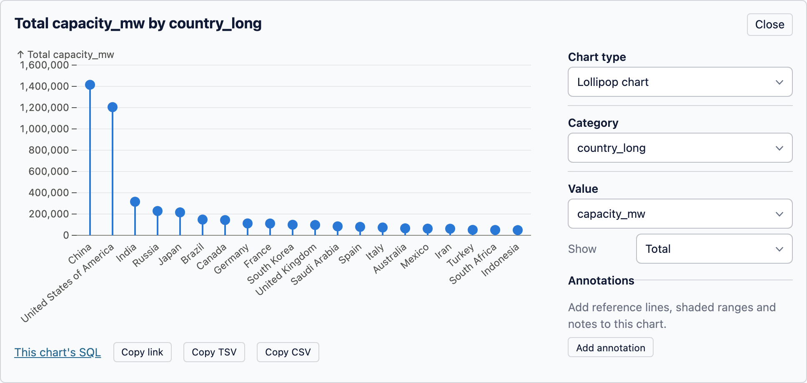
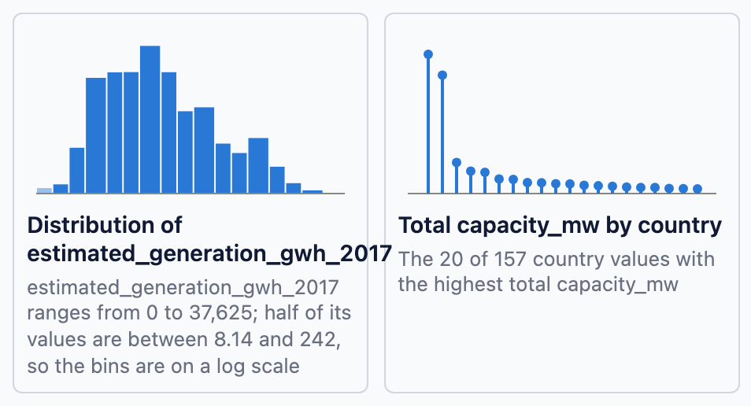
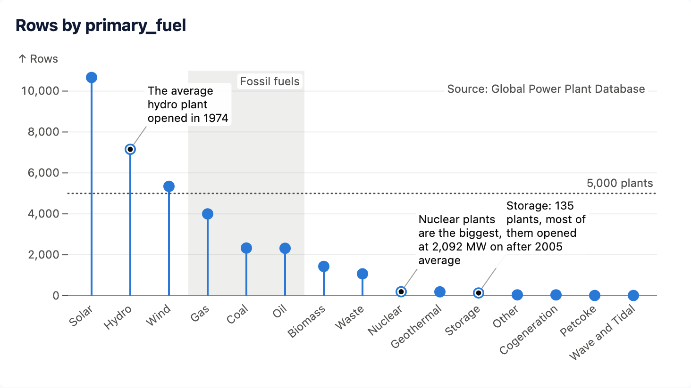
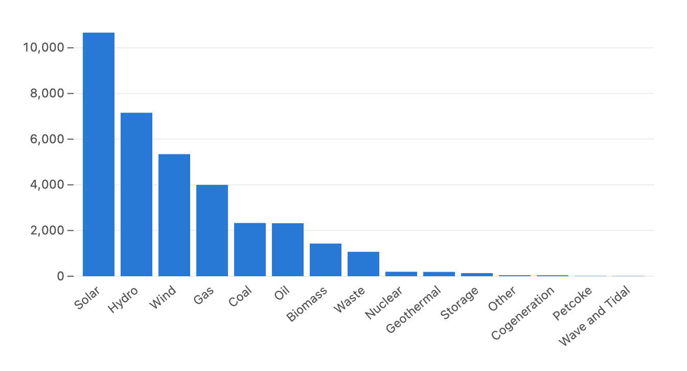
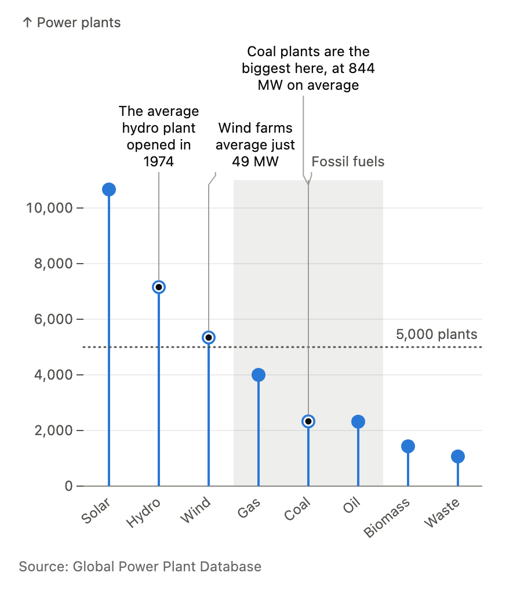
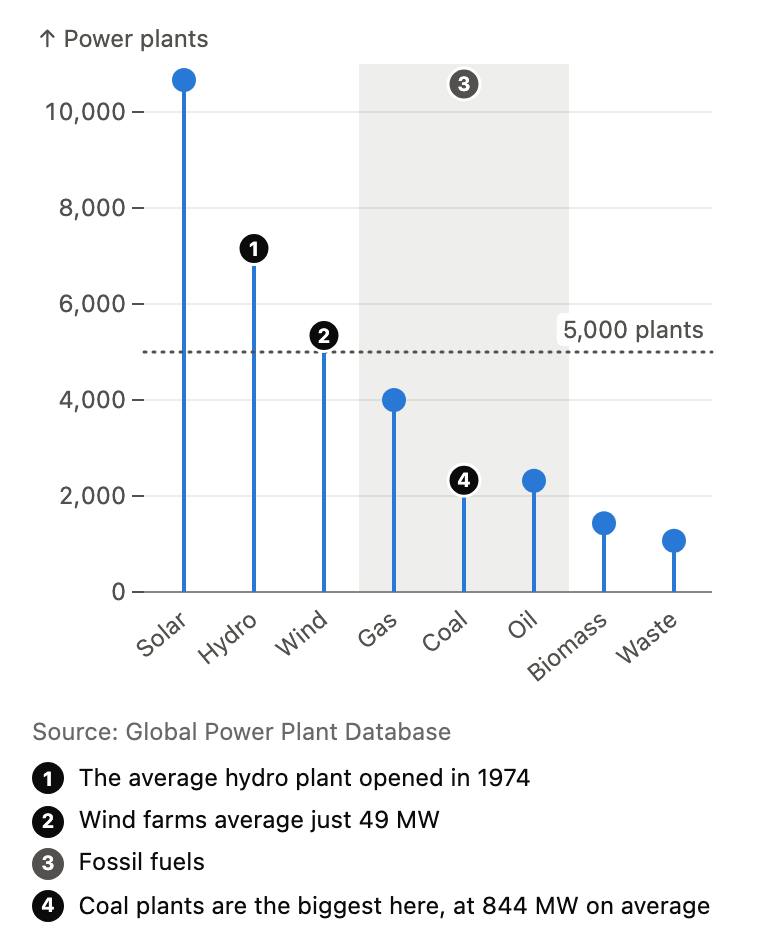

# Writing chart type plugins

A chart type has two halves. A Python class proposes charts for a table or query and compiles each one to SQL. A JavaScript module draws the rows that SQL returns. Other plugins add chart types with the `register_chart_types` hook, which is how the built-in ones are registered too. A chart type from a plugin shows up in the chart builder, can be suggested next to the built-in charts, works in `#chart=` links, `<datasette-chart>` embeds and Datasette Agent, and can draw annotations.

This page starts with a tutorial that builds a chart type plugin from nothing, then documents both halves: the Python classes, the profile that suggestions are worked out from, and the JavaScript helpers every renderer is handed.

This interface is not stable yet: until it is, anything on this page could still change, and any change will be in the release notes. Only what this page documents is public. The rest of `datasette_charts`, and of its JavaScript, can change at any time.

## Contents

- [Tutorial: a lollipop chart plugin](#tutorial-a-lollipop-chart-plugin): [create the plugin](#1-create-the-plugin), [the chart type](#2-the-chart-type), [the SQL](#3-compile-a-spec-to-sql), [the renderer](#4-draw-it), [try it](#5-try-it), [suggest it](#6-suggest-it), [annotations](#7-add-annotations), [tests](#8-write-tests), [publish it](#9-publish-it), [the finished plugin](#the-finished-plugin)
- [The `ChartType` class](#the-charttype-class), [the spec](#the-spec), [the other classes](#the-other-classes) and [the rules for chart SQL](#the-rules-for-chart-sql)
- [The profile](#the-profile) and [scores and ranking](#scores-and-ranking)
- [What is not public yet](#what-is-not-public-yet)
- JavaScript: [what a renderer is handed](#what-a-renderer-is-handed), [setting up a plot](#setting-up-a-plot), [numbers and labels](#numbers-and-labels), [time buckets](#time-buckets) and [annotation helpers](#annotation-helpers)

## Tutorial: a lollipop chart plugin

This tutorial builds `datasette-lollipop`, a plugin that adds a lollipop chart: a stem and a dot for each of the top 20 values of a category, ranked by a count or a total. It is a good chart for a ranking with many values, such as the countries with the most power station capacity, where a bar chart's bars would crowd each other.

You will need [uv](https://docs.astral.sh/uv/). The finished plugin is [at the end](#the-finished-plugin).

### 1. Create the plugin

Start from the [datasette-plugin](https://github.com/simonw/datasette-plugin) cookiecutter template:

```bash
uvx cookiecutter gh:simonw/datasette-plugin
```

Answer its questions like this, and say `y` to the static directory, which is where the JavaScript goes:

```
plugin_name []: lollipop
description []: Lollipop charts for datasette-charts
hyphenated [lollipop]:
underscored [lollipop]:
github_username []: your-github-username
author_name []: Your Name
include_static_directory []: y
include_templates_directory []:
```

That makes a `datasette-lollipop` directory with the package in `datasette_lollipop/`, an empty `datasette_lollipop/static/` and a test in `tests/`. Add datasette-charts as a dependency:

```bash
cd datasette-lollipop
uv add "datasette-charts>=0.4a0"
```

This tutorial needs datasette-charts 0.4a0 or later, the first version with `SOURCE_CTE` and `ctx.helpers`.

### 2. The chart type

A chart type is a subclass of `ChartType`, returned from the `register_chart_types` hook. Replace everything in `datasette_lollipop/__init__.py` with this:

```python
from datasette import hookimpl
from datasette_charts import SOURCE_CTE, Candidate, Channel, ChartType, CompiledQuery

# The most lollipops one chart draws
LIMIT = 20
AGGREGATES = ("count", "sum", "avg", "min", "max")


class LollipopChart(ChartType):
    name = "lollipop"
    label = "Lollipop chart"
    description = "The top values of a category, ranked by a count or a total"
    # Shown on a suggestion's card until its thumbnail is drawn
    icon = (
        '<svg viewBox="0 0 24 24" fill="currentColor" aria-hidden="true">'
        '<rect x="4.25" y="5" width="1.5" height="16"/><circle cx="5" cy="5" r="2.5"/>'
        '<rect x="11.25" y="10" width="1.5" height="11"/><circle cx="12" cy="10" r="2.5"/>'
        '<rect x="18.25" y="14" width="1.5" height="7"/><circle cx="19" cy="14" r="2.5"/>'
        "</svg>"
    )
    js_url = "/-/static-plugins/datasette-lollipop/lollipop.js"
    channels = [
        Channel(
            name="x", label="Category", roles=("category", "boolean", "foreign_key")
        ),
        Channel(
            name="y",
            label="Value",
            roles=("measure",),
            aggregates=AGGREGATES,
            column_required=False,
        ),
    ]
    max_rows = LIMIT


@hookimpl
def register_chart_types(datasette):
    return [LollipopChart]
```

- `name` goes in every spec for this chart, as `"type": "lollipop"`. `label` is what people see in the chart builder, and `description` tells Datasette Agent's model what the chart is for.
- `icon` is shown on a suggestion's card until its thumbnail has been drawn.
- `js_url` is the JavaScript module that draws the chart. Datasette serves a plugin's `static/` directory at `/-/static-plugins/<plugin name>/`.
- `channels` are what a spec can set: here a category, `x`, and a value, `y`. The `roles` say which columns suit each one, and the builder lists those first. `aggregates` are the ways `y` can be worked out, and `column_required=False` means `y` can be a count of rows, with no column. The builder makes its controls from these, so a chart type needs no interface code of its own.
- `max_rows` is the most rows the chart's SQL can return.

`Candidate` is used in step 6.

### 3. Compile a spec to SQL

When a chart is drawn, datasette-charts checks its spec against the channels, then calls the chart type's `compile()` method for the SQL to run. A spec for the countries with the most capacity looks like this:

```json
{
  "v": 1,
  "type": "lollipop",
  "encoding": {
    "x": {"column": "country_long"},
    "y": {"column": "capacity_mw", "aggregate": "sum"}
  }
}
```

Add these to `datasette_lollipop/__init__.py`, above the class:

```python
# How each aggregate is written in titles
TITLES = {
    "count": "Count of",
    "sum": "Total",
    "avg": "Average",
    "min": "Minimum",
    "max": "Maximum",
}


def quote(name):
    "A column name, quoted for SQLite"
    return '"' + name.replace('"', '""') + '"'


def value_sql(y):
    "The SQL for each lollipop's value: count(*), or an aggregate of a column"
    if "column" not in y:
        return "count(*)"
    # The aggregate has been checked against AGGREGATES already
    return "{}({})".format(y["aggregate"], quote(y["column"]))


def value_title(y):
    "Rows, Total capacity_mw, Average price, ..."
    if "column" not in y:
        return "Rows"
    return "{} {}".format(TITLES[y["aggregate"]], y["column"])
```

And these two methods to the class:

```python
    def compile(self, spec, source, profile):
        x = spec["encoding"]["x"]["column"]
        y = spec["encoding"]["y"]
        sql = f"""
{source.with_clause()}
select {quote(x)} as key, {value_sql(y)} as value
from {SOURCE_CTE}
where {quote(x)} is not null
group by 1
order by 2 desc, 1
limit :chart_limit
"""
        return CompiledQuery(
            sql=sql,
            # A query or a filtered table has parameters of its own
            params={**(source.params or {}), "chart_limit": LIMIT},
            max_rows=LIMIT,
            meta={"x": x, "y": value_title(y)},
        )

    def title(self, spec):
        encoding = spec["encoding"]
        return "{} by {}".format(value_title(encoding["y"]), encoding["x"]["column"])
```

The SQL follows [the rules for chart SQL](#the-rules-for-chart-sql):

- It reads its rows from `SOURCE_CTE`, which `source.with_clause()` defines. The source can be a table, a filtered table or a SQL query, and the chart type does not need to know which.
- Column names are quoted. Anything else that goes into the SQL has been checked first: the column names against the source's columns, and the aggregate against `AGGREGATES`.
- It returns at most `LIMIT` rows, however big the source is.
- The limit is a named parameter, prefixed `chart_` as the built-in chart types' are. The source's own parameters go in too, since a SQL query or a filtered table can have them.

`meta` is handed to the renderer as `ctx.meta`, so it can label its axis. `title()` is the chart's title.

For that spec, `compile()` returns this SQL, with `{"chart_limit": 20}` as its parameters:

```sql
with _chart_source as (
select * from main."global_power_plant_database"
)
select "country_long" as key, sum("capacity_mw") as value
from _chart_source
where "country_long" is not null
group by 1
order by 2 desc, 1
limit :chart_limit
```

### 4. Draw it

Save this as `datasette_lollipop/static/lollipop.js`:

```javascript
// Draws the rows from LollipopChart.compile(): key and value, largest first
export function render(el, ctx) {
  const { Plot, helpers, theme } = ctx;
  const { basePlot, mount, isThumbnail, categoryName, uniqueNames } = helpers;
  const { fitBandLabels, valueAxisMargin, fmt, TIP } = helpers;
  const thumbnail = isThumbnail(ctx);
  const fontFamily = getComputedStyle(el).fontFamily;

  const keys = ctx.data.map((d) => d.key);
  // Band scales need one name per band: two keys can have the same name
  const names = uniqueNames(keys.map((key) => categoryName(key)));
  const points = ctx.data.map((d, i) => ({ name: names[i], value: d.value }));
  // Room for the value axis, and labels turned if they would run into each other
  const marginLeft = thumbnail ? 6 : valueAxisMargin(points.map((d) => d.value), fontFamily);
  const step = (ctx.width - marginLeft - 20) / Math.max(1, names.length);
  const fit = fitBandLabels(names, { step, fontFamily, ordered: false });
  const axis = Plot.axisX({ label: null, tickSize: 0, tickRotate: -fit.angle, fontSize: fit.fontSize });

  const options = basePlot(ctx, {
    marginLeft,
    marginRight: thumbnail ? 6 : 20,
    marginTop: thumbnail ? 6 : 20,
    marginBottom: thumbnail ? 6 : fit.marginBottom,
    x: { domain: names, axis: null },
    y: { label: ctx.meta.y, grid: !thumbnail, nice: true },
    marks: [
      ...(thumbnail ? [] : [axis]),
      Plot.ruleY([0], { stroke: theme.muted }),
      Plot.ruleX(points, { x: "name", y1: 0, y2: "value", stroke: theme.series[0], strokeWidth: 2 }),
      Plot.dot(points, {
        x: "name",
        y: "value",
        r: thumbnail ? 3 : 6,
        fill: theme.series[0],
        ...(thumbnail ? {} : { title: (d) => `${d.name}\n${fmt(d.value)}`, tip: TIP }),
      }),
    ],
  });
  const plot = Plot.plot(options);
  mount(el, ctx, plot);
}
```

A renderer exports `render(el, ctx)`, which draws into the element `el`. `ctx.data` holds the rows from `compile()`, and `ctx.helpers` holds the functions the built-in renderers draw with, so the chart looks like the built-in ones and follows the page's light or dark theme. `basePlot()` sets the size, font and colors, and leaves out the axes on a thumbnail. `valueAxisMargin()` makes room for the value axis's labels, `fitBandLabels()` turns the category labels when they would run into each other, and `mount()` puts the plot on the page. The [JavaScript reference](#what-a-renderer-is-handed) covers every helper.

### 5. Try it

You need a database to chart. The [Global Power Plant Database](https://github.com/wri/global-power-plant-database) has 34,936 power stations, with each one's country, fuel and capacity:

```bash
curl -LO https://raw.githubusercontent.com/wri/global-power-plant-database/master/output_database/global_power_plant_database.csv
uvx sqlite-utils insert data.db global_power_plant_database global_power_plant_database.csv --csv
```

Then start Datasette with the plugin:

```bash
uv run datasette data.db
```

Open <http://127.0.0.1:8001/data/global_power_plant_database>, select "Build a chart" at the end of the row of suggested charts, and pick "Lollipop chart" as the chart type. Or open the spec from step 3 directly, with this [`#chart=` link](http://127.0.0.1:8001/data/global_power_plant_database#chart=%7B%22v%22%3A1%2C%22type%22%3A%22lollipop%22%2C%22encoding%22%3A%7B%22x%22%3A%7B%22column%22%3A%22country_long%22%7D%2C%22y%22%3A%7B%22column%22%3A%22capacity_mw%22%2C%22aggregate%22%3A%22sum%22%7D%7D%7D).



Datasette reads the JavaScript from disk each time, so a change to `lollipop.js` shows when you reload the page. A change to the Python needs Datasette to be restarted.

### 6. Suggest it

So far the chart is only drawn when someone asks for it. A chart type's `propose()` method suggests charts. It is handed [the profile](#the-profile) of the table or query: what each column holds, worked out from its values. It returns `Candidate` objects, each with a spec, a [score](#scores-and-ranking) from 0 to 1 and a reason that tells people why the chart might be worth a look.

Add this method to the class:

```python
    def propose(self, profile):
        # Measures that can be added up: none of their values is below zero
        measures = [
            column
            for column in profile.columns
            if column.role == "measure"
            and column.null_rate < 0.5
            and column.numeric["min"] >= 0
        ]
        if not measures:
            return []
        measure = measures[0]
        candidates = []
        for column in profile.columns:
            distinct = column.distinct_count
            # A category with more values than one chart shows
            if not column.has_role("category") or not distinct or distinct <= LIMIT:
                continue
            candidates.append(
                Candidate(
                    spec={
                        "v": 1,
                        "type": self.name,
                        "encoding": {
                            "x": {"column": column.name},
                            "y": {"column": measure.name, "aggregate": "sum"},
                        },
                    },
                    score=round(0.65 - 0.2 * column.null_rate, 3),
                    reason=(
                        f"The {LIMIT} of {distinct:,} {column.name} values"
                        f" with the highest total {measure.name}"
                    ),
                    signals={"distinct": distinct, "null_rate": column.null_rate},
                )
            )
        return candidates
```

It suggests a lollipop chart for a category with more than 20 values, ranked by the total of the first measure in the table whose values can be added up. A score of 0.65 is in the band for "a solid, informative chart", and a category with many missing values scores less.

`propose()` must not query the database: everything it needs is in the profile. Restart Datasette and reload the page. Among the suggestions is the top 20 of `country`, the countries' codes, by total capacity:



The table is profiled from a sample of 10,000 of its rows, which have 157 of its 167 countries. `country_long` is proposed as well, but [the ranking](#how-suggestions-are-ranked) prefers variety: a second lollipop chart of the same measure scores less, and does not make the top eight.

### 7. Add annotations

Annotations are notes on a chart: a line at a value, a shaded range, a callout on a data point or a note. They are part of the spec, and they are checked on the server, so a chart type says which it can draw. Add these two lines to the class, under `max_rows`:

```python
    annotation_types = ("line", "range", "point", "text")
    annotation_axes = {"x": "category", "y": "number"}
```

`annotation_axes` says what an annotation's `x` and `y` are on this chart: a category and a number. In the renderer, replace the last two lines of `render()`, from `const plot`, with this:

```javascript
  // Annotations can name a category by its label or by its key
  const { annotate, bandMatcher } = helpers;
  const match = bandMatcher(names, keys);
  const plot = annotate(el, ctx, (margins) => Plot.plot({ ...options, ...margins }), {
    x: { screen: "x", kind: "band", match },
    y: { screen: "y", kind: "number" },
    // The point a callout with no y is about: the dot for its category
    lookup: (annotation) => {
      const point = points.find((d) => d.name === match(annotation.x));
      return point ? { x: point.name, y: point.value } : null;
    },
    // Where each stem and its dot are, so labels keep off them
    marks: (drawn) => {
      const x = drawn.scale("x");
      const y = drawn.scale("y");
      return {
        rects: points.map((d) => {
          const middle = x.apply(d.name) + x.bandwidth / 2;
          const [top, bottom] = [y.apply(d.value) - 6, y.apply(0)];
          return { left: middle - 6, right: middle + 6, top, bottom };
        }),
        lines: [],
      };
    },
  });
  mount(el, ctx, plot);
```

`annotate()` draws the annotations into the plot, and lays out their labels clear of the data and of each other. It calls the function it is given to draw the plot, again with more room if the labels need it. `lookup` finds the point a callout with no `y` is about, and `marks` says where the data is drawn. [`annotate()`](#annotateel-ctx-make-axes) has the details.

With these annotations the chart of power stations by fuel looks like this:

```json
{
  "v": 1,
  "type": "lollipop",
  "encoding": {
    "x": {"column": "primary_fuel"},
    "y": {"aggregate": "count"}
  },
  "annotations": [
    {"type": "range", "x": "Gas", "x2": "Oil", "text": "Fossil fuels"},
    {"type": "line", "y": 5000, "text": "5,000 plants", "stroke": "dotted"},
    {"type": "point", "x": "Hydro", "text": "The average hydro plant opened in 1974"},
    {"type": "point", "x": "Nuclear", "text": "Nuclear plants are the biggest, at 2,092 MW on average"},
    {"type": "point", "x": "Storage", "text": "Storage: 135 plants, most of them opened after 2005"},
    {"type": "text", "left": 0.98, "top": 0.05, "anchor": "bottom-left", "text": "Source: Global Power Plant Database"}
  ]
}
```



In the builder, **Annotations** now has a button to add one.

### 8. Write tests

Replace `tests/test_lollipop.py` with this:

```python
import json
import sqlite3
import urllib.parse

import pytest
from datasette.app import Datasette


@pytest.fixture
def datasette(tmp_path):
    # 300 power plants in 30 countries: Country 29 has the most capacity
    path = tmp_path / "plants.db"
    db = sqlite3.connect(path)
    db.execute(
        "create table plants (id integer primary key, country text, capacity real)"
    )
    db.executemany(
        "insert into plants (country, capacity) values (?, ?)",
        [(f"Country {i % 30}", i % 30 + 1.0) for i in range(300)],
    )
    db.commit()
    db.close()
    return Datasette([str(path)])


@pytest.mark.asyncio
async def test_plugin_is_installed(datasette):
    response = await datasette.client.get("/-/plugins.json")
    assert "datasette-lollipop" in {p["name"] for p in response.json()}


@pytest.mark.asyncio
async def test_data(datasette):
    spec = {
        "v": 1,
        "type": "lollipop",
        "encoding": {
            "x": {"column": "country"},
            "y": {"column": "capacity", "aggregate": "sum"},
        },
    }
    query = urllib.parse.urlencode(
        {
            "source": json.dumps({"kind": "table", "table": "plants"}),
            "spec": json.dumps(spec),
        }
    )
    response = await datasette.client.get(f"/plants/-/charts/data.json?{query}")
    data = response.json()
    assert data["ok"], data
    assert data["title"] == "Total capacity by country"
    assert data["columns"] == ["key", "value"]
    # The top 20 of the 30 countries, largest first
    assert len(data["rows"]) == 20
    assert data["rows"][:2] == [["Country 29", 300.0], ["Country 28", 290.0]]


@pytest.mark.asyncio
async def test_suggested(datasette):
    response = await datasette.client.get("/plants/plants/-/charts/suggest.json")
    lollipops = [
        s for s in response.json()["suggestions"] if s["spec"]["type"] == "lollipop"
    ]
    assert lollipops[0]["spec"]["encoding"] == {
        "x": {"column": "country"},
        "y": {"column": "capacity", "aggregate": "sum"},
    }
    assert lollipops[0]["reason"] == (
        "The 20 of 30 country values with the highest total capacity"
    )
```

The fixture is a small database of 300 power stations in 30 countries. The tests call the same HTTP API the chart panel uses: `data.json` for a chart's rows, and `suggest.json` for the suggestions, which runs `propose()` against the database's profile. Run them with:

```bash
uv run pytest
```

### 9. Publish it

The cookiecutter's `.github/workflows/publish.yml` publishes the plugin to [PyPI](https://pypi.org/) when you create a release on GitHub, once you have set up [trusted publishing](https://docs.pypi.org/trusted-publishers/) for it there. `datasette-charts` is in the package's dependencies, so `datasette install datasette-lollipop` installs both. Say in the README what the chart type draws and which columns it needs.

### The finished plugin

`datasette_lollipop/__init__.py`:

```python
from datasette import hookimpl
from datasette_charts import SOURCE_CTE, Candidate, Channel, ChartType, CompiledQuery

# The most lollipops one chart draws
LIMIT = 20
AGGREGATES = ("count", "sum", "avg", "min", "max")

# How each aggregate is written in titles
TITLES = {
    "count": "Count of",
    "sum": "Total",
    "avg": "Average",
    "min": "Minimum",
    "max": "Maximum",
}


def quote(name):
    "A column name, quoted for SQLite"
    return '"' + name.replace('"', '""') + '"'


def value_sql(y):
    "The SQL for each lollipop's value: count(*), or an aggregate of a column"
    if "column" not in y:
        return "count(*)"
    # The aggregate has been checked against AGGREGATES already
    return "{}({})".format(y["aggregate"], quote(y["column"]))


def value_title(y):
    "Rows, Total capacity_mw, Average price, ..."
    if "column" not in y:
        return "Rows"
    return "{} {}".format(TITLES[y["aggregate"]], y["column"])


class LollipopChart(ChartType):
    name = "lollipop"
    label = "Lollipop chart"
    description = "The top values of a category, ranked by a count or a total"
    # Shown on a suggestion's card until its thumbnail is drawn
    icon = (
        '<svg viewBox="0 0 24 24" fill="currentColor" aria-hidden="true">'
        '<rect x="4.25" y="5" width="1.5" height="16"/><circle cx="5" cy="5" r="2.5"/>'
        '<rect x="11.25" y="10" width="1.5" height="11"/><circle cx="12" cy="10" r="2.5"/>'
        '<rect x="18.25" y="14" width="1.5" height="7"/><circle cx="19" cy="14" r="2.5"/>'
        "</svg>"
    )
    js_url = "/-/static-plugins/datasette-lollipop/lollipop.js"
    channels = [
        Channel(
            name="x", label="Category", roles=("category", "boolean", "foreign_key")
        ),
        Channel(
            name="y",
            label="Value",
            roles=("measure",),
            aggregates=AGGREGATES,
            column_required=False,
        ),
    ]
    max_rows = LIMIT
    annotation_types = ("line", "range", "point", "text")
    annotation_axes = {"x": "category", "y": "number"}

    def compile(self, spec, source, profile):
        x = spec["encoding"]["x"]["column"]
        y = spec["encoding"]["y"]
        sql = f"""
{source.with_clause()}
select {quote(x)} as key, {value_sql(y)} as value
from {SOURCE_CTE}
where {quote(x)} is not null
group by 1
order by 2 desc, 1
limit :chart_limit
"""
        return CompiledQuery(
            sql=sql,
            # A query or a filtered table has parameters of its own
            params={**(source.params or {}), "chart_limit": LIMIT},
            max_rows=LIMIT,
            meta={"x": x, "y": value_title(y)},
        )

    def title(self, spec):
        encoding = spec["encoding"]
        return "{} by {}".format(value_title(encoding["y"]), encoding["x"]["column"])

    def propose(self, profile):
        # Measures that can be added up: none of their values is below zero
        measures = [
            column
            for column in profile.columns
            if column.role == "measure"
            and column.null_rate < 0.5
            and column.numeric["min"] >= 0
        ]
        if not measures:
            return []
        measure = measures[0]
        candidates = []
        for column in profile.columns:
            distinct = column.distinct_count
            # A category with more values than one chart shows
            if not column.has_role("category") or not distinct or distinct <= LIMIT:
                continue
            candidates.append(
                Candidate(
                    spec={
                        "v": 1,
                        "type": self.name,
                        "encoding": {
                            "x": {"column": column.name},
                            "y": {"column": measure.name, "aggregate": "sum"},
                        },
                    },
                    score=round(0.65 - 0.2 * column.null_rate, 3),
                    reason=(
                        f"The {LIMIT} of {distinct:,} {column.name} values"
                        f" with the highest total {measure.name}"
                    ),
                    signals={"distinct": distinct, "null_rate": column.null_rate},
                )
            )
        return candidates


@hookimpl
def register_chart_types(datasette):
    return [LollipopChart]
```

`datasette_lollipop/static/lollipop.js`:

```javascript
// Draws the rows from LollipopChart.compile(): key and value, largest first
export function render(el, ctx) {
  const { Plot, helpers, theme } = ctx;
  const { basePlot, mount, isThumbnail, categoryName, uniqueNames } = helpers;
  const { fitBandLabels, valueAxisMargin, fmt, TIP } = helpers;
  const thumbnail = isThumbnail(ctx);
  const fontFamily = getComputedStyle(el).fontFamily;

  const keys = ctx.data.map((d) => d.key);
  // Band scales need one name per band: two keys can have the same name
  const names = uniqueNames(keys.map((key) => categoryName(key)));
  const points = ctx.data.map((d, i) => ({ name: names[i], value: d.value }));
  // Room for the value axis, and labels turned if they would run into each other
  const marginLeft = thumbnail ? 6 : valueAxisMargin(points.map((d) => d.value), fontFamily);
  const step = (ctx.width - marginLeft - 20) / Math.max(1, names.length);
  const fit = fitBandLabels(names, { step, fontFamily, ordered: false });
  const axis = Plot.axisX({ label: null, tickSize: 0, tickRotate: -fit.angle, fontSize: fit.fontSize });

  const options = basePlot(ctx, {
    marginLeft,
    marginRight: thumbnail ? 6 : 20,
    marginTop: thumbnail ? 6 : 20,
    marginBottom: thumbnail ? 6 : fit.marginBottom,
    x: { domain: names, axis: null },
    y: { label: ctx.meta.y, grid: !thumbnail, nice: true },
    marks: [
      ...(thumbnail ? [] : [axis]),
      Plot.ruleY([0], { stroke: theme.muted }),
      Plot.ruleX(points, { x: "name", y1: 0, y2: "value", stroke: theme.series[0], strokeWidth: 2 }),
      Plot.dot(points, {
        x: "name",
        y: "value",
        r: thumbnail ? 3 : 6,
        fill: theme.series[0],
        ...(thumbnail ? {} : { title: (d) => `${d.name}\n${fmt(d.value)}`, tip: TIP }),
      }),
    ],
  });
  // Annotations can name a category by its label or by its key
  const { annotate, bandMatcher } = helpers;
  const match = bandMatcher(names, keys);
  const plot = annotate(el, ctx, (margins) => Plot.plot({ ...options, ...margins }), {
    x: { screen: "x", kind: "band", match },
    y: { screen: "y", kind: "number" },
    // The point a callout with no y is about: the dot for its category
    lookup: (annotation) => {
      const point = points.find((d) => d.name === match(annotation.x));
      return point ? { x: point.name, y: point.value } : null;
    },
    // Where each stem and its dot are, so labels keep off them
    marks: (drawn) => {
      const x = drawn.scale("x");
      const y = drawn.scale("y");
      return {
        rects: points.map((d) => {
          const middle = x.apply(d.name) + x.bandwidth / 2;
          const [top, bottom] = [y.apply(d.value) - 6, y.apply(0)];
          return { left: middle - 6, right: middle + 6, top, bottom };
        }),
        lines: [],
      };
    },
  });
  mount(el, ctx, plot);
}
```

`tests/test_lollipop.py` is in [step 8](#8-write-tests).

## The `ChartType` class

`from datasette_charts import ChartType`. A chart type is a subclass, with class attributes for what it is and methods for what it does. Return the class, or a list of them, from the hook:

```python
from datasette import hookimpl


@hookimpl
def register_chart_types(datasette):
    return [LollipopChart]
```

Names must be unique: if two chart types have the same `name`, only one of them is used.

### `name`

The chart type's name, unique and lowercase, such as `"lollipop"`. It is the `type` of every spec for this chart.

### `label`

The name people see, such as `"Lollipop chart"`, in the chart builder's list of chart types.

### `description`

A sentence about what the chart shows, listed with the chart type in `/-/charts/types.json` and in the description of Datasette Agent's `chart` tool, which tells the model what each chart type is for.

### `icon`

An inline SVG, as a string, shown on a suggestion's card when it has no thumbnail yet. Use `fill="currentColor"` so it follows the page's colors. Defaults to no icon.

### `js_url`

The URL of the JavaScript module that draws the chart. A URL that starts with `/` is a path on the Datasette instance, so `/-/static-plugins/datasette-lollipop/lollipop.js` is the `lollipop.js` in the plugin's `static/` directory. Anything else, such as `https://...`, is used as it is.

### `get_js_url(datasette)`

Returns the renderer's URL for a Datasette instance. By default that is `js_url`, with the instance's `base_url` in front when `js_url` is a path. Override it to work the URL out another way, such as with `datasette.urls.static_plugins()`.

### `channels`

A list of [`Channel`](#channel) objects: the encoding keys a spec can set, such as `x`, `y` or `series`, and what each one takes. The spec is checked against these, and the chart builder makes its controls from them.

### `max_rows`

The most rows the chart's SQL can return, whatever the size of the source. Defaults to 500. The server enforces it, and a global cap as well: see [bound the rows](#bound-the-rows).

### `options`

Settings a spec can have that are not about columns, as `{name: {"label": ..., "values": [...], "default": ...}}`. A spec's `options` are checked against the values, and the builder shows each as a menu. The built-in bar chart has one:

```python
options = {
    "orientation": {
        "label": "Bars",
        "values": ["horizontal", "vertical"],
        "default": "horizontal",
    }
}
```

The builder sends the value as a string, so make the values strings. Read one with `(spec.get("options") or {}).get("orientation", "horizontal")`, since a spec can leave its options out.

### `annotation_types`

The kinds of annotation the renderer draws: any of `"line"`, `"range"`, `"point"` and `"text"`. Defaults to none, since the renderer has to draw them, so a spec for this chart with annotations is an error. A chart with no x or y axis can still take `"text"`, which is placed by fractions of the plot.

### `annotation_axes`

What an annotation's `x` and `y` are on this chart, by the spec's channel name: `"number"`, `"category"` or `"time"`, such as `{"x": "category", "y": "number"}`. An annotation's values are checked against these, and a chart with no axis named here cannot take annotations on it. The renderer's `axes` for [`annotate()`](#annotateel-ctx-make-axes) has to say the same.

### `annotation_series`

Whether a callout, a `point` annotation, can name a `series`, on a chart that draws more than one. Defaults to `False`. The renderer's `lookup` gets the annotation, `series` included.

### `annotation_lookup`

Whether a callout can leave out its `y`, so that the renderer looks it up from the data with `lookup`. Defaults to `True`. Set it to `False` if the renderer has no `lookup`.

### `propose(profile)`

Returns a list of [`Candidate`](#candidate) charts for a source, worked out from [its profile](#the-profile). The default proposes nothing, so a chart type can be built by hand without being suggested.

`propose()` must be a pure function of the profile: no database queries, no randomness and nothing that depends on the time. That keeps suggestions fast, the same every time and easy to test. Propose only charts worth seeing: a candidate scoring under 0.3 is dropped, and so is one whose spec is not valid. [Scores and ranking](#scores-and-ranking) explains the scale.

### `verify(candidate, ctx)`

Meant for checking a promising candidate with a cheap query, and returning it with a new score, or `None` to drop it. It is not called yet: suggestions go straight from `propose()` to the ranking. Do not rely on it.

### `validate(spec, columns)`

Returns a list of error messages for a spec, or an empty list. `columns` is the source's column names. The default checks the spec's encoding against `channels`, and its options against `options`. Override it to add rules of your own, and keep the default's:

```python
def validate(self, spec, columns):
    errors = super().validate(spec, columns)
    x, series = spec["encoding"].get("x"), spec["encoding"].get("series")
    if isinstance(x, dict) and isinstance(series, dict) and x.get("column") == series.get("column"):
        errors.append("series must be a different column from x")
    return errors
```

`validate()` sees the spec before anything is known to be right about it, so check types before using a value. `compile()` is only called with a spec that passes.

### `compile(spec, source, profile)`

Returns a [`CompiledQuery`](#compiledquery): the SQL for a chart's rows, and its parameters. `spec` has passed `validate()`. `source` is the [`Source`](#source) being charted, and `profile` is [its profile](#the-profile), for anything about the columns the SQL needs, such as a column's time format. The SQL must follow [the rules for chart SQL](#the-rules-for-chart-sql).

### `title(spec)`

The chart's title, such as `"Total capacity_mw by country_long"`. It is shown above the chart and on its suggestion's card. Defaults to `label`. Like reasons, titles are worked out from the spec alone, so they are the same every time.

### `channel(name)`

Returns the [`Channel`](#channel) in `channels` with that name, or `None`.

### `to_dict(datasette)`

What `/-/charts/types.json` lists for the chart type, which is how the browser learns about it. There is no need to override it.

## The spec

A chart's spec is JSON, the same in a `#chart=` link, an embed, the HTTP API and a suggestion:

```json
{
  "v": 1,
  "type": "lollipop",
  "encoding": {
    "x": {"column": "country_long"},
    "y": {"column": "capacity_mw", "aggregate": "sum"}
  },
  "options": {},
  "annotations": []
}
```

`v` is always 1. `encoding` has a key for each channel. `options` and `annotations` can be left out. Specs come from the browser, so they are untrusted: they hold no SQL, and they are checked before `compile()` sees them. A channel's encoding can have these keys, each only if the channel allows it:

| Key | What it is | Allowed when |
|---|---|---|
| `column` | A column of the source, checked against its columns | Always. Needed unless `column_required` is `False` |
| `aggregate` | `count`, `sum`, `avg`, `min`, `max` or `count_distinct` | It is in the channel's `aggregates` |
| `timeUnit` | `decade`, `year`, `quarter`, `month`, `week`, `day`, `hour` or `minute` | `allows_time_unit` |
| `bin` | `{"maxbins": n}`, or `{"start": a, "step": b}`, with up to 200 bins | `binnable` |
| `limit` | Keep the top N values, from 1 to 100 | `allows_limit` |
| `other` | `true` to fold the rest into an "Other" row | `allows_limit` |
| `sort` | `-value`, `value`, `key` or `-key` | `allows_sort` |

The chart type's SQL does what these mean: datasette-charts only checks them.

## The other classes

### `Channel`

`from datasette_charts import Channel`. One of a chart type's channels. It is a frozen dataclass:

| Field | What it is | Default |
|---|---|---|
| `name` | The key in the spec's `encoding`, such as `"x"` | |
| `roles` | The [column roles](#column-roles) that suit the channel. The builder lists those columns first | `()` |
| `required` | Whether a spec must set this channel | `True` |
| `aggregates` | The aggregates the channel takes, if any | `()` |
| `binnable` | Whether it takes `bin` | `False` |
| `allows_time_unit` | Whether it takes `timeUnit` | `False` |
| `label` | Its name in the builder. Defaults to `name` | `None` |
| `column_required` | `False` for a channel that can be a count of rows, `{"aggregate": "count"}`, with no column. With a column, it then needs an aggregate | `True` |
| `allows_limit` | Whether it takes `limit` and `other` | `False` |
| `allows_sort` | Whether it takes `sort` | `False` |

A channel that takes a column whose role is not in `roles` is still valid: the builder lists it under "Other columns".

### `Candidate`

`from datasette_charts import Candidate`. A suggestion, returned from `propose()`:

| Field | What it is |
|---|---|
| `spec` | The chart's spec, which must be valid |
| `score` | How good a chart it is likely to be, from 0 to 1: see [the rubric](#the-rubric) |
| `reason` | A sentence that says why, shown to people under the chart's title, such as "The 20 of 157 country values with the highest total capacity_mw" |
| `signals` | Optional. A dictionary of the facts behind the score, shown by `suggest.json?_debug=1` |

Write reasons from facts in the profile, so they are the same every time. They are for people who are not experts on charts: say what is interesting about the data, not about the chart.

### `CompiledQuery`

`from datasette_charts import CompiledQuery`. What `compile()` returns:

| Field | What it is |
|---|---|
| `sql` | The SQL for the chart's rows |
| `params` | Its named parameters, the source's own included |
| `max_rows` | The most rows it returns, usually the chart type's `max_rows` or the spec's `limit` |
| `meta` | Optional. Anything the renderer needs that is not in the rows, such as an axis label, a time unit or the bins chosen. It must be JSON, and the renderer gets it as `ctx.meta` |

The rows go to the renderer as they are, with the SQL's column names: `ctx.rows` as arrays and `ctx.data` as objects.

### `Source`

`from datasette_charts import Source`. What is being charted: a table or view, a filtered table, a SQL query or a stored query. `compile()` gets one, already checked against what the person may see. What a chart type uses:

| | What it is |
|---|---|
| `with_clause()` | `with _chart_source as (...)`: the start of every chart's SQL |
| `params` | The source's own named parameters, or `None`. A SQL query, a stored query or a filtered table can have them |
| `kind` | `"table"`, `"query"` or `"stored_query"` |
| `database` | The database's name |
| `table` | The table or view, for a table |
| `query_name` | The stored query's name, for a stored query |
| `label` | A short name for it: the table, the stored query or `"query"` |

The other attributes are used by datasette-charts itself.

### `SOURCE_CTE`

`from datasette_charts import SOURCE_CTE`. The name of the CTE that `with_clause()` defines, `"_chart_source"`. A chart's SQL selects from it.

## The rules for chart SQL

### Select from the source

Start with `source.with_clause()` and select from `SOURCE_CTE`. To add CTEs of your own, follow it with a comma:

```python
sql = f"""
{source.with_clause()},
_chart_counts as (select {quote(x)} as key, count(*) as n from {SOURCE_CTE} group by 1)
select key, n from _chart_counts order by n desc limit :chart_limit
"""
```

### Prefix your CTEs `_chart_`

A table can have any name, including one your SQL uses for a CTE. All the CTEs in datasette-charts start `_chart_`, so only a table whose name starts `_chart_` could clash. Name yours the same way. To read another table in the database, such as a lookup table, write it as `main."table"`, which a CTE never hides.

### Quote identifiers

Put every column and table name in double quotes, with any double quote in it doubled: `'"' + name.replace('"', '""') + '"'`. The spec's column names have been checked against the source's columns, and its aggregates and other values against fixed lists, but they still go into the SQL as quoted names or as parameters, never as they are.

### Bound the rows

A chart's SQL must return a limited number of rows however big the source is: group, bin or take the top N, and end with a `limit`. datasette-charts enforces it too. It runs your SQL as `select * from (...) limit :chart_row_cap`, with room for one row more than `max_rows`, or than the `hard_max_rows` setting, 5,000 rows by default, if that is lower. If that extra row comes back, the chart says only the first rows are shown. The query also has Datasette's SQL time limit.

### Use named parameters

Pass values as named parameters, not in the SQL. Prefix their names `chart_`, as the built-in chart types do: a query page whose SQL has `chart_` parameters, such as the "This chart's SQL" link, gets no chart panel of its own, and the source's own parameters are less likely to clash. Include the source's parameters: `{**(source.params or {}), "chart_limit": 20}`. `chart_row_cap` is taken.

## The profile

`propose()` and `compile()` are handed a profile of the source: what each column holds, worked out from its values by datasette-charts. Its classes cannot be imported from `datasette_charts`, but the attributes here are the ones a chart type can rely on. Like the rest of this page, they could still change before the interface is stable.

A big source is profiled from a sample of its rows, so counts in the profile can be lower than in the whole source. Charts still query every row.

### `Profile`

| Attribute | What it is |
|---|---|
| `columns` | A [`ColumnProfile`](#columnprofile) for each column, in order |
| `column(name)` | The column with that name, or `None` |
| `column_names` | The names of the columns |
| `with_role(role)` | The columns with that [role](#column-roles), as their main role or a secondary one. `with_role(role, secondary=False)` for the main role only |
| `row_count` | Rows in the source, or `None` if it could not be counted in time |
| `row_count_exact` | Whether `row_count` is exact |
| `basis` | `"full"`, or `"sample"` when the columns were profiled from a sample |
| `rows_profiled` | How many rows the columns were profiled from |
| `primary_keys` | The table's primary key columns |
| `pairs` | Columns that go together, such as `{"kind": "latlon", "latitude": "lat", "longitude": "lng"}` |
| `is_view` | Whether the source is a view |

### `ColumnProfile`

| Attribute | What it is |
|---|---|
| `name`, `position` | The column's name, and its place in the source from 0 |
| `role` | What the column is for: one of the [column roles](#column-roles) |
| `secondary_roles` | Other roles it can play, such as `["category"]` for a year |
| `has_role(role)` | Whether `role` is its role or a secondary one |
| `evidence` | Why it got its role, in short phrases such as `"numeric values"` |
| `declared_type` | The type in the table's schema, such as `"REAL"`, or `None` |
| `type_counts` | How many values of each storage type: `{"integer": ..., "real": ..., "text": ..., "blob": ..., "null": ...}` |
| `non_null` | How many values are not null |
| `present` | How many are neither null nor an empty string |
| `null_rate` | The share of values that are null, from 0 to 1 |
| `distinct_count` | How many different values, or `None` when there are more than 1,000 or it is not known |
| `top_values` | The most common values, as `[[value, count], ...]`, most common first: up to 20, for columns with few enough values |
| `numeric` | For numbers: `{"min", "max", "mean", "stddev"}`, and for measures `"quantiles"` as well, or `None` |
| `text` | For text: `{"min_length", "max_length", "mean_length"}`, or `None` |
| `temporal` | For dates and times, a [`TemporalInfo`](#temporalinfo), or `None` |
| `is_pk` | Whether it is the primary key |
| `foreign_key` | `{"table", "column", "label_column"}` if it references another table, or `None` |

### Column roles

| Role | What it means |
|---|---|
| `temporal` | Dates or times: see `temporal`. A column of years also has the secondary role `category` |
| `measure` | Numbers worth adding up or averaging. One with up to 50 values that repeat is also a `category` |
| `category` | Values that repeat: up to 500 of them, and at most half as many as there are rows. Integers with up to 12 values are categories first, and `measure` second |
| `boolean` | Two values, such as 0 and 1 or yes and no. Also a `category` |
| `foreign_key` | References another table. Also a `category` if its values repeat |
| `identifier` | Identifies rows: a primary key, unique values, or a name such as `id` or `uuid` |
| `latitude`, `longitude` | A pair of coordinate columns, also listed in `pairs` |
| `text` | Free text that rarely repeats |
| `url`, `email`, `json` | Structured text |
| `blob` | Binary data |
| `constant` | One value, or all null |
| `unknown` | Mixed types, or nothing else fits |

### `TemporalInfo`

| Attribute | What it is |
|---|---|
| `kind` | How the times are written: `"iso_date"`, `"iso_datetime"`, `"unix_seconds"`, `"unix_ms"` or `"year"` |
| `min`, `max` | The earliest and latest, as ISO 8601 text |
| `match_rate` | The share of values that are times of that kind |
| `has_offset` | Whether any value has a time zone, such as `Z` or `+01:00` |

## Scores and ranking

### The rubric

Scores are on one scale for every chart type, so that a plugin's suggestions rank fairly against the built-in ones:

| Score | What it means |
|---|---|
| 0.9 and up | Almost certainly something to see first, such as a map of a table with coordinates |
| 0.6 to 0.9 | A solid, informative chart |
| 0.3 to 0.6 | Plausible but unremarkable |
| Under 0.3 | Not worth proposing: it is dropped |

For comparison, on the power plants table the built-in map scores 0.92, the bar chart of rows by fuel 0.74, the histogram of capacity 0.66, and the box plot of capacity by fuel 0.62. Things that should raise or lower a score: how well the columns' roles fit, null rates, how many values a category has (a handful to a few dozen is best), whether one value dominates, how long a time series is, and column names such as `price` or `id`.

### How suggestions are ranked

All the chart types' candidates are ranked together, and the top eight are shown (the `max_suggestions` setting). They are picked one at a time, best first, with each candidate's score adjusted against the ones already picked:

- 0.06 less for each one of the same chart type
- up to 0.1 less for showing the same columns as one already picked
- 0.04 more for bringing in a column none of them shows
- one chart of the same type and columns as one already picked is left out, such as the same columns with a different aggregate

The shown score is the adjusted one. Ties break on the chart type's name, then the columns' positions, so the order is the same every time.

### Checking your scores

`/<db>/<table>/-/charts/suggest.json?_debug=1` lists each suggestion with its `signals`: the candidate's own score, as `raw_score`, the adjustments, and the `signals` the candidate was given.

## What is not public yet

The built-in chart types use helpers that are not part of this interface yet, and can change at any time: SQL for time buckets, bins, measures and aggregates (`datasette_charts.sqlgen`), foreign key label lookups (`label_sql()` in `datasette_charts.chart_types.bar`), the scoring helpers in `datasette_charts.chart_types.base`, and `quote()` and `table_ref()` in `datasette_charts.sources`. A chart type can import them, but may break with any release. The small ones are easy to write yourself, as the tutorial does with `quote()`. The built-in chart types in [`datasette_charts/chart_types/`](../datasette_charts/chart_types/) show how they are used.
## What a renderer is handed

A chart type's renderer is the JavaScript module at its `js_url`. It exports a `render(el, ctx)` function, which draws the chart into the element `el`, from the rows `compile()` returned. It is loaded with `import()` the first time a chart of that type is drawn.

`ctx.helpers` holds the functions the built-in renderers draw with. They are the very same functions, so a renderer that uses them looks like the built-in charts, follows the page's light or dark theme and can draw [annotations](../README.md#annotations). Only the helpers on this page are public: the rest of `renderers/common.js` and `renderers/annotations.js` can change at any time. New helpers will be added over time.

In the examples, `// =>` shows what an expression returns. The test suite runs every one of those against the real helpers and checks the result. Results that depend on the browser's fonts say so, and come from Chromium on macOS. Unless an example says otherwise, `ctx` is a full-size chart 640 pixels wide on a white page.

### `ctx`

A renderer can rely on these fields of `ctx`. Any others are internal to this plugin and can change.

| Field | What it holds | Example |
|---|---|---|
| `spec` | The chart's spec, annotations included | `{v: 1, type: "lollipop", encoding: {...}, annotations: [...]}` |
| `rows` | The rows the chart type's SQL returned, as arrays | `[["Solar", 10665], ["Hydro", 7156]]` |
| `columns` | The names of those columns | `["key", "value"]` |
| `data` | The same rows as objects keyed by column name | `[{key: "Solar", value: 10665}, {key: "Hydro", value: 7156}]` |
| `meta` | What the chart type's `compile()` returned as `meta`, such as the time unit | `{timeUnit: "month", y: "Count"}` |
| `size` | `"full"` or `"thumbnail"`. Thumbnails have no axes, labels or legends | `"full"` |
| `width`, `height` | The size to draw at, in pixels. Full-size charts are at least 320 wide and 340 high; thumbnails are 208 by 112 | `640`, `340` |
| `Plot`, `d3` | [Observable Plot](https://observablehq.com/plot/) and [D3](https://d3js.org/), as bundled with this plugin | |
| `theme` | The colors for the page the chart is on, light or dark (below) | |
| `helpers` | The helpers on this page, as a frozen object | `{fmt, basePlot, annotate, ...}` |

The renderer does no data fetching: the rows are already aggregated by the chart type's SQL.

### `ctx.theme`

The theme is picked from the background the chart actually sits on, so it follows whatever theme the page uses, not just the operating system's setting.

| Token | What it holds | Light | Dark |
|---|---|---|---|
| `mode` | `"light"` or `"dark"` | `"light"` | `"dark"` |
| `surface` | The background behind the chart | `"rgb(255, 255, 255)"` | the page's own, such as `"rgb(17, 26, 53)"` |
| `ink` | Text that should stand out | `"#0b0b0b"` | `"#f0efec"` |
| `ink2` | Ordinary text, such as tick labels | `"#52514e"` | `"#c3c2b7"` |
| `muted` | Rules and secondary marks | `"#898781"` | `"#898781"` |
| `grid` | Gridlines | `"#e1e0d9"` | `"#2c2c2a"` |
| `series` | Eight colors for series, in the order to use them | `["#2a78d6", "#eb6834", ...]` | `["#3987e5", "#d95926", ...]` |
| `other` | The color for an "Other" series, and any series past the eighth | `"#a8a69f"` | `"#6f6e69"` |
| `sequential` | Two ends of a color ramp, the first for values near zero | `["#cde2fb", "#0d366b"]` | `["#104281", "#cde2fb"]` |
| `land` | Land on a map | `"#ecebe6"` | `"#2c2c2a"` |

The whole light theme:

```javascript
ctx.theme
// => {
//   mode: "light",
//   surface: "rgb(255, 255, 255)",
//   series: ["#2a78d6", "#eb6834", "#1baf7a", "#eda100", "#e87ba4", "#008300", "#6250d6", "#e34948"],
//   sequential: ["#cde2fb", "#0d366b"],
//   other: "#a8a69f",
//   land: "#ecebe6",
//   grid: "#e1e0d9",
//   muted: "#898781",
//   ink: "#0b0b0b",
//   ink2: "#52514e"
// }
```

## Setting up a plot

### `basePlot(ctx, options)`

The options every plot starts from: the chart's size, its font and text color, and a transparent background. A full-size chart gets a 44 pixel bottom margin, room for an x axis label under the ticks. A thumbnail gets no axes and a 6 pixel margin all round, so one renderer can draw both sizes.

- `ctx`: the renderer's `ctx`.
- `options`: any [Plot options](https://observablehq.com/plot/features/plots). They are merged over the defaults, one level deep: passing `style` replaces the whole `style` object.
- Returns an options object for `Plot.plot()`.

```javascript
const plot = Plot.plot(
  basePlot(ctx, {
    marginLeft: 60,
    y: { label: ctx.meta.y, grid: !isThumbnail(ctx), nice: true },
    marks: [Plot.barY(ctx.data, { x: "key", y: "value", fill: ctx.theme.series[0] })],
  })
);
```

```javascript
basePlot(ctx, { marginLeft: 60 })
// => {
//   width: 640,
//   height: 340,
//   style: { background: "transparent", color: "#52514e", fontFamily: "inherit", fontSize: "12px", overflow: "visible" },
//   marginBottom: 44,
//   marginLeft: 60
// }

basePlot({ ...ctx, size: "thumbnail", width: 208, height: 112 })
// => {
//   width: 208,
//   height: 112,
//   style: { background: "transparent", color: "#52514e", fontFamily: "inherit", fontSize: "12px", overflow: "visible" },
//   axis: null,
//   margin: 6
// }
```

### `mount(el, ctx, plot)`

Puts a drawn plot into `el`, replacing whatever was there. Call it last, with the plot `annotate()` returned. It also sets what Plot reads from CSS: tooltips are filled with the theme's `surface` color, so they match a dark page, and the plot never gets wider than its container.

- `el`: the element `render()` was given.
- `ctx`: the renderer's `ctx`.
- `plot`: what `Plot.plot()` returned, an `<svg>`, or a `<figure>` when the plot has a legend.
- Returns nothing.

```javascript
const plot = Plot.plot(basePlot(ctx, { marks }));
mount(el, ctx, plot);
```

After that, in Chromium, the start of `el.innerHTML` is the plot's `<svg>` with those two styles set:

```html
<svg class="plot-d6a7b5" fill="currentColor" font-family="system-ui, sans-serif" font-size="10" text-anchor="middle" width="640" height="340" viewBox="0 0 640 340" style="background: none; color: rgb(82, 81, 78); font-family: inherit; font-size: 12px; overflow: visible; --plot-background: rgb(255, 255, 255); max-width: 100%;">
```

### `isThumbnail(ctx)`

Whether the chart is a thumbnail, in the row of suggestions. Thumbnails are 208 by 112 pixels, with no axes, labels, legends or tooltips, so leave out anything that only makes sense at full size.

- `ctx`: the renderer's `ctx`.
- Returns `true` or `false`.

```javascript
const thumbnail = isThumbnail(ctx);
const dots = Plot.dot(ctx.data, {
  x: "x",
  y: "y",
  r: thumbnail ? 1.5 : 3,
  ...(thumbnail ? {} : { title: (d) => fmt(d.y), tip: TIP }),
});
```

```javascript
isThumbnail(ctx) // => false
isThumbnail({ ...ctx, size: "thumbnail" }) // => true
```

### `TIP`

Options for Plot's tooltips, which give the lines of a tooltip a little more space than Plot does. Spread it into a `Plot.tip()` mark, or pass it as a mark's `tip` option. It is frozen, so copy it to change it: `{ ...TIP, fontSize: 13 }`.

```javascript
// A tooltip on each bar
Plot.barY(bars, { x: "name", y: "value", title: (d) => `${d.name}\n${fmt(d.value)}`, tip: TIP });

// One tooltip that follows the pointer along a line
Plot.tip(points, Plot.pointerX({ x: "date", y: "value", title: (d) => fmt(d.value), ...TIP }));
```

```javascript
TIP // => { lineHeight: 1.3 }
```

### `xLabel(label)`

Axis options that put the x axis label centred under the ticks, where it cannot run into them. `basePlot()` leaves room for it. Spread it into the `x` options.

- `label`: the label, usually a column name.
- Returns `{label, labelAnchor}`.

```javascript
basePlot(ctx, { x: { ...xLabel(ctx.meta.x), grid: true }, marks });
```

```javascript
xLabel("capacity_mw") // => { label: "capacity_mw", labelAnchor: "center" }
```

### `valueAxisMargin(values, fontFamily)`

A left margin wide enough for the tick labels of a value axis showing `values`, such as "1,200,000", which Plot's default margin would cut off. It is never less than 56 pixels. It measures the text, so it needs a browser.

- `values`: the numbers the axis shows. Anything that is not a finite number is ignored.
- `fontFamily`: the font the labels are drawn in, `getComputedStyle(el).fontFamily`. Defaults to `"system-ui, sans-serif"`.
- Returns a number of pixels.

```javascript
const fontFamily = getComputedStyle(el).fontFamily;
const marginLeft = isThumbnail(ctx) ? 6 : valueAxisMargin(ctx.data.map((d) => d.value), fontFamily);
```

In Chromium, inside the plugin's panel, whose font is `system-ui, -apple-system, "Segoe UI", sans-serif`:

```javascript
valueAxisMargin([120, 4500, 1200000], fontFamily) // 75
valueAxisMargin([-25000, 18000], fontFamily) // 66
valueAxisMargin([3, 12, 48], fontFamily) // 56
valueAxisMargin([], fontFamily) // 56
```

## Numbers and labels

### `fmt(value)`

A number as it should read in a tooltip: with thousands separators and at most two decimal places. `null` and `undefined` become an empty string, and anything else is turned into a string as it is. Years read badly with separators, so write those with `String(year)`.

- `value`: anything.
- Returns a string.

```javascript
Plot.barY(bars, { x: "name", y: "value", title: (d) => `${d.name}\n${fmt(d.value)}`, tip: TIP });
```

```javascript
fmt(1284.567) // => "1,284.57"
fmt(0.125) // => "0.13"
fmt(1000000) // => "1,000,000"
fmt(2009) // => "2,009"
fmt(null) // => ""
fmt("n/a") // => "n/a"
```

### `fmtCompact(value)`

A number short enough to write beside a mark, such as a value at the end of a bar: whole numbers from 100, and K, M and B from 10,000. Anything that is not a number goes through `fmt()`.

- `value`: anything.
- Returns a string.

```javascript
Plot.text(bars, { x: "name", y: "value", text: (d) => fmtCompact(d.value), dy: -7, fill: ctx.theme.ink2 });
```

```javascript
fmtCompact(7.25) // => "7.25"
fmtCompact(1284.567) // => "1,285"
fmtCompact(12900) // => "12.9K"
fmtCompact(-15300) // => "-15.3K"
fmtCompact(4210000) // => "4.2M"
fmtCompact(null) // => ""
```

### `truncate(text, max)`

`text` cut to at most `max` characters, the last of them an ellipsis. Use it for tick labels, which cannot wrap.

- `text`: anything, turned into a string.
- `max`: the most characters to keep, the ellipsis included.
- Returns a string.

```javascript
y: { label: null, domain: names, tickFormat: (name) => truncate(name, 28) }
```

```javascript
truncate("United States of America", 16) // => "United States o…"
truncate("France", 16) // => "France"
```

### `categoryName(key, isOther, label)`

The name to show for a category value. Use it for every category and series name, so that they read the same as on the built-in charts.

- `key`: the value from the row.
- `isOther`: whether this row is the "Other" bucket that the top N leaves behind. Built-in chart types return an `is_other` column for this.
- `label`: the label of a foreign key, if the column is one. Built-in chart types return it in a `label` column.
- Returns a string: "Other", the label, the key, `"(null)"` or `"(empty)"`.

```javascript
const names = ctx.data.map((d) => categoryName(d.key, d.is_other, d.label));
```

```javascript
categoryName("CA", false, "California") // => "California"
categoryName("CA", false) // => "CA"
categoryName(null, false) // => "(null)"
categoryName("", false) // => "(empty)"
categoryName(null, true) // => "Other"
```

### `uniqueNames(names)`

Makes a list of names unique by numbering repeats, since a band scale needs one name per band. Two keys can share a foreign key label, such as two towns with the same name.

- `names`: a list of strings.
- Returns a new list of the same length.

```javascript
const names = uniqueNames(ctx.data.map((d) => categoryName(d.key, d.is_other, d.label)));
```

```javascript
uniqueNames(["Springfield", "Shelbyville", "Springfield", "Springfield"])
// => ["Springfield", "Shelbyville", "Springfield (2)", "Springfield (3)"]
```

### `seriesColor(theme, index)`

The color for the series at `index`, counting from 0. The colors are never reused: past the eighth series, every one is drawn in the theme's `other` color.

- `theme`: `ctx.theme`.
- `index`: the series' place, largest first. Leave out "Other" when counting, and give it `theme.other`.
- Returns a color.

```javascript
let slot = 0;
const range = series.map((s) => (s.other ? theme.other : seriesColor(theme, slot++)));
const plot = Plot.plot(basePlot(ctx, { color: { domain: series.map((s) => s.name), range, legend: true }, marks }));
```

```javascript
seriesColor(ctx.theme, 0) // => "#2a78d6"
seriesColor(ctx.theme, 1) // => "#eb6834"
seriesColor(ctx.theme, 7) // => "#e34948"
seriesColor(ctx.theme, 8) // => "#a8a69f"
```

### `textWidth(text, font)`

The width of `text` in pixels, measured with a canvas.

- `text`: anything, turned into a string.
- `font`: a CSS font, such as `"12px system-ui"`.
- Returns a number.

```javascript
const fontFamily = getComputedStyle(el).fontFamily;
const widest = Math.max(...bars.map((d) => textWidth(fmtCompact(d.value), `12px ${fontFamily}`)));
// Only write values above the bars if they fit
const showValues = widest + 4 <= step;
```

In Chromium:

```javascript
textWidth("1,200,000", "12px system-ui") // 56.26171875
textWidth("Wave and Tidal", `12px ${fontFamily}`) // 85.763671875
```

### `fitBandLabels(labels, options)`

How to write the labels of a band axis, such as one under upright bars, so they do not run into each other. These are tried in order, until the labels fit:

1. level, at 12px, if they fit side by side
2. turned 40 degrees, at 12px, then smaller, down to 9px
3. turned 60 degrees, then upright, at 9px
4. for ordered values such as years only, every second label, or every third, and so on

Named categories never lose a label: if they do not fit upright, they are drawn upright at 9px anyway.

- `labels`: the labels as they will be written, already truncated.
- `options.step`: how many pixels each band takes along the axis.
- `options.fontFamily`: the font, `getComputedStyle(el).fontFamily`.
- `options.ordered`: whether labels may be left out, from [`orderedValues()`](#orderedvalueskeys).
- Returns `{fontSize, angle, every, marginBottom, overhang}`: the font size, the angle to turn the labels by, to write every Nth label, the bottom margin the turned labels need, and how far the first label reaches left of the middle of its band, for the left margin.

It measures the labels, so it needs a browser. The [tutorial's renderer](#4-draw-it) uses it:

```javascript
const marginLeft = thumbnail ? 6 : valueAxisMargin(points.map((d) => d.value), fontFamily);
const step = (ctx.width - marginLeft - 20) / Math.max(1, names.length);
const fit = fitBandLabels(names, { step, fontFamily, ordered: false });
const axis = Plot.axisX({ label: null, tickSize: 0, tickRotate: -fit.angle, fontSize: fit.fontSize });

const options = basePlot(ctx, {
  marginBottom: thumbnail ? 6 : fit.marginBottom,
  x: { domain: names, axis: null },
  marks: [
    ...(thumbnail ? [] : [axis]),
    // ...
  ],
});
```

For the 20 countries with the most capacity, 640 pixels wide, `valueAxisMargin()` leaves a 75 pixel margin for labels up to "1,600,000", so each band is 27.25 pixels. In Chromium, `fitBandLabels()` returns `{fontSize: 12, angle: 40, every: 1, marginBottom: 116, overhang: 25}`:



Some more cases, in Chromium:

```javascript
fitBandLabels(["Solar", "Hydro", "Wind"], { step: 180, fontFamily, ordered: false })
// { fontSize: 12, angle: 0, every: 1, marginBottom: 44, overhang: 0 }

// Sixty years in 564 pixels: smaller, steeper, and every second one
const years = Array.from({ length: 60 }, (_, i) => String(1960 + i));
fitBandLabels(years, { step: 9.4, fontFamily, ordered: true })
// { fontSize: 9, angle: 60, every: 2, marginBottom: 41, overhang: 11 }

// The same labels as names, which must all be kept: upright
fitBandLabels(years, { step: 9.4, fontFamily, ordered: false })
// { fontSize: 9, angle: 90, every: 1, marginBottom: 40, overhang: 1 }
```

### `orderedValues(keys)`

Whether category keys are ordered numbers or dates, such as years, going up or down. Labels for those can be thinned out without losing track of which bar is which. It needs at least three keys.

- `keys`: the raw keys from the rows. Leave out the "Other" row.
- Returns `true` or `false`.

```javascript
const realKeys = ctx.data.filter((d) => !d.is_other).map((d) => d.key);
const fit = fitBandLabels(labels, { step, fontFamily, ordered: orderedValues(realKeys) });
```

```javascript
orderedValues([2019, 2020, 2021]) // => true
orderedValues(["2026-01", "2026-02", "2026-03"]) // => true
orderedValues([2021, 2019, 2020]) // => false
orderedValues(["Coal", "Gas", "Hydro"]) // => false
orderedValues([2019, 2020]) // => false
```

## Time buckets

A chart type that groups rows by time gets them back labelled by bucket, as the built-in chart types' SQL writes them. Each unit has its own form:

| Unit | Bucket |
|---|---|
| `decade` | `"1990"` |
| `year` | `"2026"` |
| `quarter` | `"2026-Q4"` |
| `month` | `"2026-11"` |
| `week` | `"2026-11-16"`, the Monday the week starts on |
| `day` | `"2026-11-22"` |
| `hour` | `"2026-11-22T10"` |
| `minute` | `"2026-11-22T10:30"` |

These helpers turn them into dates, step from one to the next and write them for people to read. All of them work in UTC.

### `bucketToDate(bucket, unit)`

The `Date` a time bucket starts at.

- `bucket`: the bucket from the row.
- `unit`: the time unit, which built-in chart types return as `meta.timeUnit`.
- Returns a `Date`, or `null` if the bucket cannot be read.

```javascript
const points = ctx.data
  .map((d) => ({ date: bucketToDate(d.bucket, ctx.meta.timeUnit), value: d.value }))
  .filter((d) => d.date);
Plot.lineY(points, { x: "date", y: "value" });
```

```javascript
bucketToDate("1990", "decade") // => new Date("1990-01-01T00:00:00.000Z")
bucketToDate("2026-Q4", "quarter") // => new Date("2026-10-01T00:00:00.000Z")
bucketToDate("2026-11-16", "week") // => new Date("2026-11-16T00:00:00.000Z")
bucketToDate("2026-11-22T10:30", "minute") // => new Date("2026-11-22T10:30:00.000Z")
bucketToDate("November", "month") // => null
```

### `stepDate(date, unit)`

The start of the next bucket.

- `date`: the start of a bucket.
- `unit`: the time unit.
- Returns a new `Date`.

```javascript
// A bar for each bucket, from its start to the start of the next
Plot.rectY(points, { x1: "date", x2: (d) => stepDate(d.date, ctx.meta.timeUnit), y: "value" });
```

```javascript
stepDate(bucketToDate("2026-Q4", "quarter"), "quarter") // => new Date("2027-01-01T00:00:00.000Z")
stepDate(bucketToDate("2026-11-16", "week"), "week") // => new Date("2026-11-23T00:00:00.000Z")
```

### `fmtBucket(date, unit)`

A bucket written for people to read, for tooltips and category labels.

- `date`: the start of a bucket.
- `unit`: the time unit.
- Returns a string.

```javascript
Plot.tip(points, Plot.pointerX({ x: "date", y: "value", title: (d) => `${fmtBucket(d.date, unit)}\n${fmt(d.value)}`, ...TIP }));
```

```javascript
fmtBucket(bucketToDate("1990", "decade"), "decade") // => "1990s"
fmtBucket(bucketToDate("2026", "year"), "year") // => "2026"
fmtBucket(bucketToDate("2026-Q4", "quarter"), "quarter") // => "Q4 2026"
fmtBucket(bucketToDate("2026-11", "month"), "month") // => "Nov 2026"
fmtBucket(bucketToDate("2026-11-16", "week"), "week") // => "Week of 16 Nov 2026"
fmtBucket(bucketToDate("2026-11-22", "day"), "day") // => "22 Nov 2026"
fmtBucket(bucketToDate("2026-11-22T10", "hour"), "hour") // => "22 Nov 2026, 10:00"
fmtBucket(bucketToDate("2026-11-22T10:30", "minute"), "minute") // => "22 Nov 2026, 10:30"
```

### `allBuckets(dates, unit, max)`

Every bucket from the first date to the last, so that a bucket with no rows can be drawn as a gap or a zero instead of being skipped over. Data that comes at a regular step of several buckets, such as one row a decade bucketed by year, keeps its own step: only a missing step counts as a gap.

- `dates`: the buckets that have rows, as dates, in any order.
- `unit`: the time unit.
- `max`: the most buckets worth filling in. Defaults to 2,000.
- Returns a list of dates, or `null` if there would be more than `max`.

```javascript
const present = ctx.data.map((d) => bucketToDate(d.bucket, unit));
const buckets = allBuckets(present, unit) || present;
const byTime = new Map(ctx.data.map((d) => [bucketToDate(d.bucket, unit).getTime(), d.value]));
const points = buckets.map((date) => ({ date, value: byTime.get(date.getTime()) ?? 0 }));
```

```javascript
const months = ["2026-01", "2026-02", "2026-05"].map((bucket) => bucketToDate(bucket, "month"));
allBuckets(months, "month").map((date) => fmtBucket(date, "month"))
// => ["Jan 2026", "Feb 2026", "Mar 2026", "Apr 2026", "May 2026"]

const decades = ["1950", "1960", "1980"].map((bucket) => bucketToDate(bucket, "year"));
allBuckets(decades, "year").map((date) => fmtBucket(date, "year"))
// => ["1950", "1960", "1970", "1980"]

const days = ["2026-01-01", "2026-01-31"].map((bucket) => bucketToDate(bucket, "day"));
allBuckets(days, "day", 10) // => null
```

## Annotation helpers

### `annotate(el, ctx, make, axes)`

Draws the spec's annotations into a plot: lines, shaded ranges, callouts on data points and notes. They are drawn into the plot's own SVG with the scales Plot worked out, so they line up exactly with the marks. Every label is laid out together with the others, clear of the data and of each other. When the labels need room outside the plot, `annotate()` draws the plot again with more. Text always goes in as text, never as HTML.

If the spec has no annotations, or the chart is a thumbnail, it returns the plot untouched, so call it for every chart.

- `el`: the element `render()` was given.
- `ctx`: the renderer's `ctx`. The annotations come from `ctx.spec.annotations`.
- `make`: a function, `make(margins)`, that draws the plot with `Plot.plot()` and returns it. `margins` is `{}` the first time. It may be called again with any of `marginTop`, `marginRight` and `height`, which must override the renderer's own. A plot already drawn can be passed instead, but then labels cannot be given room outside the plot, so they go in a numbered key when they do not fit on it.
- `axes`: how the spec's x and y map to the plot (below).
- Returns the plot, to pass to `mount()`.

The `axes` object:

| Key | What it is |
|---|---|
| `x`, `y` | One for each of the spec's channels that annotations can name: `{screen, kind}`, with `match` for a band axis |
| `screen` | The Plot scale the channel is drawn on: `"x"`, `"y"`, or `"fy"` for facets. On a horizontal bar chart the spec's x is drawn down the side, so it is `{screen: "y"}` |
| `kind` | `"band"` for categories, `"time"` or `"number"` |
| `match(value)` | For a band axis: the band an annotation's value names, or `null`. [`bandMatcher()`](#bandmatchernames-keys) makes one |
| `lookup(annotation)` | Optional. The data point a callout with no `y` points at, as `{x, y}`, with `x` a value on the x scale (a band name, a `Date` or a number), or `null` |
| `marks(plot)` | Optional. Where the data is drawn, in pixels, as `{rects: [{left, top, right, bottom}], lines: [[{X, Y}, ...]]}`, so that labels can keep off it |

The chart type's [`annotation_types`](#annotation_types), [`annotation_axes`](#annotation_axes), [`annotation_series`](#annotation_series) and [`annotation_lookup`](#annotation_lookup) have to say the same as `axes`. The server checks annotations against them before the renderer sees them. A chart with no straight x or y axis, such as a map or a calendar, can take `"text"` notes only, and passes `{}` as `axes`.

[Step 7 of the tutorial](#7-add-annotations) is a whole example, with `lookup` and `marks`.

#### Labels that do not fit

`annotate()` lays the labels out in one of three ways, picked each time the chart is drawn:

1. **Beside what they label**, when every one fits there, clear of the data, the other labels and the edges of the plot, and callouts read in the same order as their points. That is the chart in [step 7](#7-add-annotations), 700 pixels wide.
2. **In lanes**, when they do not. Labels move to a band above the plot, in order along the axis, each with a thin leader to what it labels. `annotate()` calls `make()` again with a bigger `marginTop` and `height`, to make room. On a chart whose x axis runs down the side, the lanes go on the right, with a bigger `marginRight`. Notes become captions under the chart.
3. **As a numbered key**, when lanes would not fit either. Each label becomes a small numbered badge on the chart, and the texts are listed under it.

The same chart at 480 pixels wide has its labels in lanes above the plot, and the note as a caption:



At 360 pixels wide, the lanes would not fit either, so the labels become a numbered key:



A renderer does nothing for any of this. The captions and the numbered key are added under the chart after `render()` returns, and so is a note for each annotation that could not be drawn, such as a category the chart does not show.

### `bandMatcher(names, keys)`

Makes the `match()` function for a band axis. It finds the band an annotation names by the band's label first, then by its raw key, so `"CA"` and `"California"` both find the California bar.

- `names`: the bands' names, as the band scale's domain has them.
- `keys`: the raw keys from the rows, in the same order. Use `null` for an "Other" row, which no key should match.
- Returns a function, `match(value)`, that returns a name from `names`, or `null`.

```javascript
const names = uniqueNames(ctx.data.map((d) => categoryName(d.key, d.is_other, d.label)));
const match = bandMatcher(names, ctx.data.map((d) => (d.is_other ? null : d.key)));
annotate(el, ctx, make, { x: { screen: "x", kind: "band", match }, y: { screen: "y", kind: "number" } });
```

```javascript
const match = bandMatcher(["California", "Oregon", "Other"], ["CA", "OR", null]);
match("Oregon") // => "Oregon"
match("CA") // => "California"
match("Texas") // => null
```

### `parseMoment(value)`

The period an annotation's time value names. A value is written as precisely as it needs to be: `2009` is all of 2009, and `"2009-06"` all of June 2009. Use it in `lookup()` on a time axis, to find the bucket a callout points at.

- `value`: a year as a number, or a string: `"2009"`, `"2009-Q2"`, `"2009-06"`, `"2009-06-15"`, `"2009-06-15T10"`, `"2009-06-15T10:30"` or `"2009-06-15T10:30:00"`.
- Returns `{start, end}`, two dates, with `end` the start of the next period. Or `null` if the value is not one of those.

```javascript
// The point a callout on a line chart points at: the bucket that holds x
lookup: (annotation) => {
  const period = parseMoment(annotation.x);
  if (!period) return null;
  const time = period.start.getTime();
  const point = points.find((d) => d.date.getTime() <= time && time < stepDate(d.date, unit).getTime());
  return point ? { x: point.date, y: point.value } : null;
},
```

```javascript
parseMoment(2009)
// => { start: new Date("2009-01-01T00:00:00.000Z"), end: new Date("2010-01-01T00:00:00.000Z") }
parseMoment("2009-Q2")
// => { start: new Date("2009-04-01T00:00:00.000Z"), end: new Date("2009-07-01T00:00:00.000Z") }
parseMoment("2009-06")
// => { start: new Date("2009-06-01T00:00:00.000Z"), end: new Date("2009-07-01T00:00:00.000Z") }
parseMoment("2009-06-15T10:30")
// => { start: new Date("2009-06-15T10:30:00.000Z"), end: new Date("2009-06-15T10:31:00.000Z") }
parseMoment("June 2009") // => null
```
